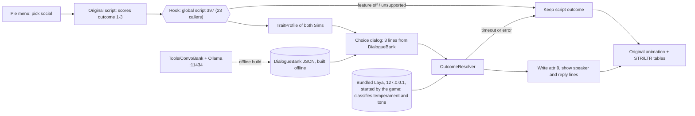

# AI-Driven Social Conversations Design

**Spec**: `.specs/features/ai-conversations/spec.md`
**Status**: Draft

---

## 1. How it works today (verified by decoding the game's scripts)

Details and numbers: `docs/architecture/RELATIONSHIPS.md`.

1. The player picks a social in the pie menu. The Sim's `Interaction - X` script creates a "social object" and pushes
   `X - Person A` onto the actor and `X - Person B` onto the receiver.
2. `X - Person A` computes a **score** from the receiver (Hug: relationship x2 + mood + outgoing/10, minus 30 for same sex;
   Kiss: relationship + mood, minus 25; Insult: niceness/10 + mood) and maps it to **outcome 1, 2 or 3** by fixed thresholds.
3. It calls global script `397 enable social outcome choice?`. That returns true only if bit 2 of `Global[25]` (a debug flag)
   is set; then the script shows a 3-button dialog and the player forces the outcome. Otherwise the score's outcome stays.
4. The outcome lives in **attribute 9 of the social object**. Animations, sounds and the STR deltas (`Tuning <name>` tables)
   are chosen from it. No text is ever shown.

## 2. What changes

**Decisions (user, 2026-11-21):** Laya is installed with the game and the game starts its own Laya server; outcome policy B (script outcome plus or minus one step); text shown as balloons, choice as a dialog; Ollama used only to build the bank offline.

**Spike findings that change the design** (`spike-results.md`): the hook seam is 18 scripts, not 23. Laya answers in 44 ms (p95 76 ms) but cannot judge "how will the receiver react" (about 0.33 each, an insult was rated warm). It classifies text well (tone, and a person's temperament from a description). So Laya's job is **classification**, and a small compatibility table makes the outcome.

Keep steps 1, 2 and 4. Replace what happens at step 3: instead of a debug dialog, our code (a) asks the player which of 3 lines to say
and (b) sets attribute 9 from the receiver's Laya-classified temperament, the tone of the chosen line, and the script's own outcome (policy B).
Everything else (animations, STR/LTR, family-friend dialogs, decay) runs unmodified.



## 3. Comparison: existing vs proposed

| Aspect | Existing (original scripts) | Proposed |
|---|---|---|
| Player agency | Pick the social only. Outcome by hidden score. | Pick the social, then one of 3 lines. |
| Outcome inputs | Mood, relationship, one personality trait (varies per social), same-sex penalty. | All personality traits, profession and level, interests, mood, relationship, plus the chosen tone. |
| Who decides | Fixed thresholds in the script (e.g. Hug 110/205). | Laya classifies; script score is prior and fallback. |
| Text | None (icons, Simlish, animation). | Speaker line + receiver reply per outcome. |
| Relationship change | `Tuning <name>` tables per outcome. | **Same tables, same outcome slots.** |
| Latency | 0. | Laya about 35 ms, called ahead of time; never on the frame. |
| Network / services | None. | Laya and Ollama optional; absent = original behavior. |
| Determinism | Fully deterministic given state. | Outcome stored in attr 9, so a save/load is consistent; the choice itself is not reproducible without the stored value. |
| Testing | Hard to test (scripts). | Pure logic unit-tested (like `ModeLogic`); hook covered by patch tests and e2e. |

## 4. Pros and cons

**Pros**
- Reuses the game's own seam: the outcome attribute and the existing 3-button choice mechanism, so animations and numbers need no change.
- No AI call in the frame loop. The bank is pre-generated; Laya answers in tens of ms and is pre-fetched.
- Fully reversible: off switch plus automatic fallback means a broken Laya/Ollama never breaks the game.
- Fits the repo pattern: pure logic + Cecil-patched hook + offline tool + tests + CI.
- Balance preserved: STR/LTR still come from the original tables.

**Cons and risks**
- A fixed bank repeats lines over a long game. Mitigation: 3 variants per bucket, many trait buckets, background refill (P3).
- Sim traits are 0-1000 numbers; they must be bucketed into a small set or the bank explodes. Quality depends on those buckets.
- **Measured:** Laya cannot judge reactions (spike: about 0.33 per option, an insult rated "warm"), so it must not decide the outcome. It is used only to classify text, where it did well (tone 4 of 5, temperament 3 of 4 clear), and a table plus the one-step limit decide the outcome.
- **Bundling cost:** PyTorch with CUDA is 4.4 GB and the weights 2.3 GB. Shipping that with a game that is a few hundred MB is heavy; an ONNX build may help. Open item.
- **Security:** Laya listens on 0.0.0.0 by default. The launcher must force 127.0.0.1 and an API key.
- **Process lifecycle:** a crashed game could leave a GPU-holding server behind; a job object handles it.
- **Startup time:** the first Laya call takes about 1.1 s plus model load; warm-up must overlap the loading screen.
- Hooking a data script (BHAV 397) means patching at content-load time. If a different game version or expansion renames or renumbers it, the hook silently stops. Mitigation: patch tests assert the hook is present and `397` has exactly 23 callers.
- A blocking dialog inside a running VM thread needs the engine's async wait path; a mistake could freeze a Sim. Reuse the existing `VMDialog` primitive path instead of inventing one.
- Small local models (gemma3:4b at 3.9B parameters) write generic or occasionally off-tone lines. Mitigation: a validation pass (length, language, banned words), a review sheet, and hand-fixing.
- Content/safety: generated text is shown to the player; build-time filtering is required.

## 5. How it fits the architecture

| Layer (see `docs/architecture/ARCHITECTURE.md`) | Change |
|---|---|
| FSO.SimAntics (VM), `tso.simantics` | Unchanged source. One BHAV (397) is rewritten when its IFF is loaded. |
| `Simitone.Client` UI | One new dialog (3 choices) via the existing dialog route (`VMDialogInfo` -> `UIMobileAlert`-style) and balloon text. |
| Mod layer, `Tools/` | New: `Tools/Conversations` (pure logic: `TraitProfile`, `Bucketing`, `DialogueBank`, `OutcomeResolver`), `Tools/ConvoBank` (offline Ollama builder), `Tools/ConversationsPatch` (Cecil patch that registers the hook and redirects 397), `Tools/Conversations.Tests`. |
| Content | `Content/conversations/bank.json` (generated, versioned) and an override file for hand edits. |
| External | Laya at `localhost:8000/v1/systemone` (runtime, optional). Ollama at `localhost:11434` (build time, optional runtime refill). |
| Docs and CI | `ci.ps1` builds and tests the new tools; `PatchTests` checks the patcher on the pristine release. |

Patches must still run on the original DLLs, like the existing patchers. Source under `FreeSO/` is not edited.

## 6. Code reuse

| Existing | Location | Use |
|---|---|---|
| Pure-logic + test pattern | `Tools/SpriteCards/ModeLogic.cs`, `Tools/SpriteCards.Tests` | Same structure for `Conversations` |
| Cecil patcher pattern | `Tools/SpriteCardsPatch/Program.cs` | New patcher, same idempotency rules |
| Options menu entry and live green highlight | `SpriteCards.Decorate`, `UIMainPanel.Switcher_OnCategorySelect` patch | On/off toggle (CONV-09) |
| Script decoder | `Tools/ScriptDump` | Spike to verify 397 and callers; test fixture |
| Dialog primitive | `FSO.SimAntics/Primitives/VMDialog*`, `VMDialogInfo` | Async choice UI |
| Trait access | `VMAvatar.GetPersonData(VMPersonDataVariable)`: Nice/Active/Generous/Playful/Outgoing/Neat (2-7), JobType (56), JobPromotionLevel (57), Interest_* (46-53), PersonsAge (58), Gender (65); motive `Mood` | `TraitProfile` extractor |
| Balloon text | `set_balloon_headline` primitive and `VMEntity.Headline` | Show lines |
| Test harness | `Tools/SimTool`, `Tools/e2e/Run-E2E.ps1`, `Tools/ci.ps1` | e2e and CI |

## 7. Components

### TraitProfile (pure)
- **Purpose**: Turn raw Sim data into a small bucketed profile.
- **Interfaces**: `TraitProfile.From(RawSim)`; `Bucket Key` string, e.g. `outgoing:H|nice:L|job:medical|mood:good|interest:music`.
- **Notes**: personalities to 3 levels (L/M/H); profession to ~10 groups from `JobType`; mood to 3 levels; one top interest.

### DialogueBank (pure)
- **Interfaces**: `Get(interaction, tone, outcome, bucketKey, rng) -> LinePair`; falls back from specific to generic bucket, then to a built-in template.
- **Data**: `bank.json`: `{ interaction, tone[3], outcome[1-3], bucket, speaker[], reply[] }`.

### OutcomeResolver (pure)
- **Interfaces**: `Resolve(scoreOutcome, temperament?, tone, interaction) -> int` (1-3).
- **Rule**: a table `(interaction family x tone x temperament) -> shift in {-1, 0, +1}`; result = clamp(scoreOutcome + shift, 1, 3). No temperament (Laya unavailable) means shift 0, i.e. the original outcome. Policy B is enforced by construction: the shift can never exceed one step.
- Temperaments (from the spike): `easily_offended`, `thick_skinned`, `cold`, `receptive`. Tones: hostile, neutral, kind, romantic, playful.

### LayaClient (game hook, async)
- **Interfaces**: `ClassifyTemperament(profile) -> Task<Temperament?>` (cached per Sim and mood bucket); `ClassifyTone(line) -> Task<Tone?>` (only for lines not pre-labelled in the bank). Timeout 150 ms, pre-fetched when the player opens the pie menu.
- **Contract (verified in the spike)**: `POST /v1/systemone`, `state.body` = a short text description, one `choice` question with named categories, answer in `answers.<q>.choice` plus `probabilities`. Median 44 ms, p95 76 ms, first call about 1.1 s. Accept the answer only above a probability floor (to be tuned in T7).
- **Not used for**: judging reactions (spike: about 0.33 each).

### LayaHost (launcher side)
- **Purpose**: Start, warm up and stop the bundled Laya server for the game's lifetime (CONV-12).
- **Behavior**: set `LAYA_HOST=127.0.0.1`, a free `LAYA_PORT`, a random `LAYA_API_KEY`, `LAYA_MODELS=english`; start the process hidden; poll `/health`; send one warm-up request; hand port and key to the hook; kill the process tree on exit (job object so a crash also kills it); refuse to reuse a server it did not start.
- **Location**: in the Cecil-patched `Program.Main` startup path (same place as `SpriteCards.Startup`), implemented in `Tools/Conversations`.
- **Open**: packaging (see spec "Still open"). Until decided, LayaHost looks for `laya` in a bundled folder first, then in a system Python.

### ConversationHook (game hook)
- **Interfaces**: `OnSocialOutcome(VMStackFrame ctx) -> VMPrimitiveExitCode`: reads attr 9 and both Sims, opens the choice dialog (async), writes attr 9, queues balloon lines.
- **Reuses**: dialog wait path of `VMDialog`.

### ConversationsPatch (Cecil)
- **Purpose**: register primitive opcode (e.g. 200) at startup, and rewrite instruction 0 of BHAV 397 at IFF load to call it.
- **Notes**: patch `Program.Main` startup like `SpriteCards.Startup`; BHAV rewrite via a postfix on the IFF read path; idempotent.

### ConvoBank (offline tool)
- **Purpose**: For each (interaction x outcome x tone x bucket) ask Ollama for 3 variants, validate, write `bank.json` plus a review sheet.
- **Interfaces**: `convobank --model gemma3:4b --out bank.json [--interactions hug,kiss]`; resumable; seeded.
- **Estimate (not measured)**: about 23 x 3 x 3 x ~12 buckets x 3 variants = about 7,500 lines, in batches of 10 = about 750 calls; roughly 25 minutes at 2 s per call on a 4B model.

## 8. Data models

```csharp
class RawSim { string Name; short[] Personality /*6*/; short Job, JobLevel, Age, Gender; short Mood; short[] Interests /*8*/; }
class TraitProfile { string Key; string Summary; /* for Laya and for prompts */ }
class LinePair { string Speaker; string Reply; }
class BankEntry { string Interaction; int Tone; int Outcome; string Bucket; List<LinePair> Lines; }
```

Relationship numbers are not part of this model: the game scripts own them.

## 9. Error handling

| Scenario | Handling | User impact |
|---|---|---|
| Laya down or slow (>150 ms) | Use script outcome, log once | None |
| Laya returns outside {1,2,3} | Ignore, use script outcome | None |
| Bank file missing or invalid JSON | Disable feature, built-in templates only | Generic lines or original game |
| No bank entry for bucket | Fall back to generic bucket, then template | Less specific line |
| Dialog dismissed (Escape) | Treat as "no choice": script outcome, neutral line | None |
| Hook not found in patcher | Patcher fails loudly; PatchTests fail in CI | Build-time only |
| Unsupported receiver (pet, child, NPC) | Skip hook | Original behavior |

## 10. Tech decisions

| Decision | Choice | Rationale |
|---|---|---|
| Hook point | Global BHAV 397 | Already called by all 23 social scripts right after the score, with attr 9 set |
| Text source at runtime | Pre-generated bank | No latency, reviewable, testable |
| Laya timing | Pre-fetch, 150 ms cap | Laya is about 35 ms but the VM must never wait on the network |
| Outcome policy | Policy B: script outcome plus a table-driven shift of at most one step | Keeps game feel while adding trait awareness (decided) |
| Laya's role | Classifier of temperament and tone | Measured: good at classification, uninformative at judging reactions |
| Laya lifecycle | Started and stopped by the game | Decided: one launch, no second program |
| Persistence | Outcome in attr 9 (already saved), choice not stored | Save/load stays consistent |

## 11. Spike questions: status (details in `spike-results.md`)

1. Stack object in 397 and attr 9: **answered by script reading** (social object; attr 9 plain attribute). In-game proof still to do.
2. Does the dialog wait path accept caller-supplied button text: **open**.
3. Laya speed and fitness: **answered** (fast; classification yes, reaction judgment no).
4. Social scripts that do not call 397: **answered** (Talk, Say Goodbye, Call Over, Move In, Stereo Dance, sofa socials and a few others).
5. New: Laya packaging size and CPU speed: **open**.
