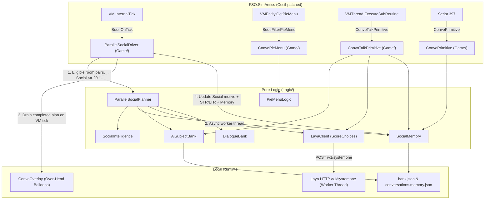

# Autonomous Parallel Room Social & AI-Only Talk/Romance Design

**Spec**: `.specs/features/autonomous-parallel-social/spec.md`

## Architecture Overview

Every new capability follows the repository's strict **Pure Logic vs Game Hook** split:
- `Tools/Conversations/Logic/` (pure C#, `net461` + `net9.0` compatible, zero game-assembly types, 100% unit-tested in `Conversations.Tests`).
- `Tools/Conversations/Game/` (thin `FSO.SimAntics` / `FSO.Client` adapters invoked from Cecil-patched hooks).
- `Tools/SpriteCardsPatch/Program.cs` (idempotent Mono.Cecil IL patches verified in `Tools/PatchTests`).



---

## Component Design

### 1. Extended Sim Profile & Skills (`Logic/Traits.cs`)

Extend `RawSim` (preserving all existing defaults/fields for backward compatibility):
- `short Social = 100;` (`-100..100`, where `60%` = `+20`)
- `short Cooking, Charisma, Mechanical, Creativity, Body, Logic;` (`0..1000`, matching Sims 1 `VMPersonDataVariable.*Skill`, 100 per skill point)
- `short NeighborId;` (for stable per-pair memory keys; falls back to `Name` when 0)
- `short StrToTarget, LtrToTarget;` (`-100..100`, directional relationship)
- `short TargetStrToMe, TargetLtrToMe;` (`-100..100`)

Define `enum SkillKind { None = -1, Cooking = 0, Charisma = 1, Mechanical = 2, Creativity = 3, Body = 4, Logic = 5 }` and helper `RawSim.SkillValue(SkillKind)` + `RawSim.TopSkills(int minLevel = 300)` + `RawSim.SocialPercent(short social)` (`(social + 100) * 0.5`).

---

### 2. Laya Probability Scoring (`Logic/LayaClient.cs`)

Extend `LayaClient` without breaking any existing method or test:
- `public static Dictionary<string, double> ParseProbabilities(string response)`: parses `answers.q.probabilities` into a `Dictionary<string, double>` (returns `null` on missing/malformed payloads).
- `public Dictionary<string, double> ScoreChoices(string text, string question, IEnumerable<string> criteria)`: calls `/v1/systemone` via `transport.Post` with the existing failure/pause circuit breaker and returns normalized probabilities across all criteria (or `null` when unavailable/failed).
- No extra network overhead: `ParallelSocialPlanner` runs on `ThreadPool.QueueUserWorkItem`, never on the VM tick thread.

---

### 3. AI-Only Talk Subject Catalog (`Logic/AiSubjectBank.cs` + `bank.json`)

Replaces raw TS1 interest strings (`"Travel and Toys"`, `"Sixties and School"`, etc.) with rich AI-generated subjects:

```csharp
public class AiSubject
{
    public string Id;              // e.g. "secret_family_recipes"
    public string Title;           // e.g. "Secret Family Recipes" (shown in button & balloon)
    public int Interest;           // 0..7 mapping to Sims 1 interest slot (for engine attr 2 & liking)
    public SkillKind Skill = SkillKind.None; // optional skill affinity
    public Tone ToneHint = Tone.Gentle;
    public string Description;     // short semantic hint sent to Laya
}
```

- `BankFile` gains `[JsonProperty("subjects")] public List<AiSubject> Subjects = new List<AiSubject>();`.
- `AiSubjectBank`:
  - Loads from `BankFile.Subjects` (validating each subject's `Title` via `DialogueBank.IsAcceptable` and verifying `Interest` is `0..7` and NOT equal to any raw TS1 interest string).
  - Ships a curated built-in catalog of **48 AI-authored subjects** (6 per interest domain, covering all 6 skills + careers + everyday Sims life) so even without `bank.json` or when using an older bank, 100% of subjects are still AI-authored subjects.
  - `SelectCandidates(RawSim speaker, RawSim listener, SocialKnowledge knowledge, SocialMemory memory, int count, Random rng)`: picks a diverse pool of candidate AI subjects biased by speaker interests, speaker/known-listener skills, career relevance, and avoiding recently failed `subjectId`s in `SocialMemory`.
  - `OfferForManualTalk(RawSim speaker, RawSim listener, LayaClient laya, SocialMemory memory, Random rng)`: returns **3 distinct AI subjects** for manual `Talk` (using Laya scoring when available, deterministic fallback otherwise, and ensuring 3 distinct subjects spanning speaker taste, listener taste, and wildcard/skill match).
  - `Tools/ConvoBank` gets a `--subjects` mode using Ollama to generate/expand `bank.json`'s `"subjects"` array with Laya/filter validation.

---

### 4. Social Memory & Anti-Negative-Loop Learning (`Logic/SocialMemory.cs`)

Keyed by pair `(speakerKey, listenerKey)` (using NeighborId when `> 0`, else normalized Name):

```csharp
public class PairMemory
{
    public int Exchanges;
    public int PositiveCount;
    public int NegativeCount;
    public int NegativeStreak;
    public int BackoffRemaining;   // parallel ticks/turns to cool down after 3+ consecutive negatives
    public Dictionary<string, OptionStats> Interactions; // key: interaction (e.g. "joke", "flirt")
    public Dictionary<string, OptionStats> Subjects;     // key: subjectId
    public Dictionary<string, OptionStats> Tones;        // key: "0"|"1"|"2"
    public HashSet<int> LearnedInterests;                // listener interest indices discovered
    public HashSet<string> LearnedSkills;                // listener skills discovered
}

public class OptionStats
{
    public int Successes;
    public int Failures;
    public int LastOutcome;      // 1 = bad, 2 = ok, 3 = great
    public int LastSeenTurn;     // monotonic pair turn counter for decay
}
```

**Learning & Anti-Negative-Loop Rules**:
1. **Record(pair, interaction, tone, subjectId, quality, listenerInterestIndex, listenerTopSkill)**:
   - Increments `Exchanges`.
   - If `quality == 1` (bad): `NegativeCount++`, `NegativeStreak++`, increments `Failures` on interaction, tone, and (if talk) subjectId. If `NegativeStreak >= 3`, sets `BackoffRemaining = 3` (skips the next 3 eligible parallel trigger cycles for this pair).
   - If `quality == 3` (great): `PositiveCount++`, `NegativeStreak = 0`, `BackoffRemaining = 0`, increments `Successes`.
   - If `quality == 2` (neutral): `NegativeStreak = Math.Max(0, NegativeStreak - 1)`.
   - Also adds `listenerInterestIndex` / `listenerTopSkill` to `LearnedInterests` / `LearnedSkills` so the speaker literally learns what the listener likes over repeated conversations!
2. **Penalty(pair, interaction / subjectId / tone)**:
   - Recent failure (`LastOutcome == 1` within the last 6 pair turns): strong penalty (`-0.55` scaled by decay `1 / (1 + age * 0.25)` and failure count).
   - Past success (`Successes > Failures`): gentle bonus (`+0.15` capped at `+0.30`).
3. **Anti-Negative-Loop Mode**:
   - `NegativeStreak >= 2`: **De-escalation mode**!
     - Hard-forbids risky/negative/provocative interactions (`tease`, `brag`, `flirt`) and `Tone.Bold`.
     - Boosts repair/safe interactions: `apologize` (`+0.45`), `talk` (`+0.35`), `cheerup` (`+0.25`), `compliment` (`+0.20`), and `Tone.Gentle` (`+0.30`).
   - `NegativeStreak >= 3` (`BackoffRemaining > 0`): `ShouldBackoff(pair)` returns `true` and decrements `BackoffRemaining`, giving the pair breathing room instead of looping negatively.
4. **Persistence**: JSON serialization to `Documents/Simitone/conversations.memory.json` (atomic temp-file swap, swallows all I/O/parse errors).

---

### 5. Social Intelligence: Knowledge, Skills & Mood (`Logic/SocialIntelligence.cs`)

Computes how accurately a Sim perceives the listener and selects the right interaction/topic:

1. **Knowledge of the Other Sim (`Knowledge`, `0.0 .. 1.0`)**:
   - `relScore = Clamp01(((ltr + 20) / 120.0) * 0.65 + ((str + 20) / 120.0) * 0.35)`
   - `historyScore = Clamp01(pairMemory.Exchanges / 10.0)`
   - `Knowledge = Clamp01(0.10 + 0.55 * relScore + 0.35 * historyScore)`
   - Controls visibility into listener in the Laya prompt & heuristic scoring:
     - `Knowledge < 0.35` (Stranger): listener temperament & interests are described as `"unknown / hard to read"`; listener skills & mood only dimly guessed unless Charisma is high.
     - `0.35 <= Knowledge < 0.70` (Acquaintance): partial visibility (mood + dominant trait + any `LearnedInterests`/`LearnedSkills`).
     - `Knowledge >= 0.70` (Close): full accurate visibility into listener's temperament, mood, top skills, and interests!
2. **Skills (`Charisma` + Shared/Known Skills)**:
   - `charismaNorm = Clamp01(speaker.Charisma / 1000.0)` (Sims 1: 0..10 skill points = 0..1000).
   - `SkillReadingBonus`: high Charisma (`>= 500`) helps read listener mood & temperament even at lower knowledge (`effectiveReading = Clamp01(knowledge * 0.75 + charismaNorm * 0.35)`).
   - `SharedSkillBonus(subject)`: if `subject.Skill != None`, adds affinity when speaker has `skill >= 300`, and extra resonance when listener also has `skill >= 300` (visible to speaker if `knowledge >= 0.45` or skill was learned in memory!).
3. **Mood (`SpeakerMood` & `PerceivedListenerMood`)**:
   - `speakerMoodNorm = Clamp01((speaker.Mood + 100) / 200.0)` (`0.0` miserable, `0.5` neutral, `1.0` elated).
   - **Judgment Accuracy (`0.20 .. 0.98`)**:
     `Accuracy = Clamp(0.25 + 0.35 * Knowledge + 0.25 * charismaNorm + 0.15 * speakerMoodNorm, 0.20, 0.98)`
   - **Misjudgment Noise**: `(1.0 - Accuracy)` drives bounded stochastic perturbation so low-knowledge, low-Charisma, bad-mood Sims genuinely make awkward choices sometimes—while high-knowledge, high-Charisma, happy Sims consistently pick great interactions and topics!
   - **Bad-Mood Skew**: when `speaker.Mood < -30`, speaker is more impatient/blunt (slight bias toward `brag`/`tease`/`Bold` unless anti-negative-loop de-escalation overrides it).
   - **Listener Bad-Mood Adaptation**: when `listener.Mood < -30` AND speaker reads it (`effectiveReading >= 0.45`), speaker boosts `cheerup`, gentle `talk`, and `compliment`, and penalizes `tease`/`brag`/`joke`.

---

### 6. Parallel Social Planner (`Logic/ParallelSocialPlanner.cs`)

Pure-logic planner invoked on a background thread for a candidate room pair:

- **Trigger Threshold**: `SocialThreshold = 20` (exact `60%` of `[-100, +100]`: `(20 + 100) / 200 = 0.60`).
- **Parallel Verbal Interaction Pool**:
  `{ "talk", "compliment", "joke", "brag", "cheerup", "apologize", "flirt", "tease" }`
  - `flirt` only enabled when `STR >= 35 && LTR >= 20` and not in de-escalation mode.
  - `apologize` enabled when `NegativeStreak >= 1` or `STR < 15`.
  - `cheerup` enabled when speaker perceives listener mood `< 0` (or `NegativeStreak >= 1`).
  - `tease` disabled when `NegativeStreak >= 2` or speaker `Nice > 750`.
- **Two-Stage Laya Decision**:
  1. **Interaction Selection**:
     - Builds a rich natural-language prompt describing speaker personality, mood, Charisma/skills, what speaker knows about listener (redacted by `Knowledge`), and learned memory notes (e.g., `"Previously, joking went badly with Betty."`).
     - Calls `laya.ScoreChoices(prompt, InteractionQuestion, candidateCriteria)` (returns probability per candidate interaction).
     - Blends Laya probabilities (`0.55` weight when available) with deterministic `SocialIntelligence` affinity + `SocialMemory` penalties/bonuses + de-escalation overrides + `(1 - Accuracy)` noise!
  2. **AI Subject Selection** (when `talk` is chosen):
     - Selects up to 5 candidate AI subjects from `AiSubjectBank` (avoiding recently failed subjects when accuracy is decent).
     - Calls `laya.ScoreChoices(topicPrompt, SubjectQuestion, subjectCriteria)` to let Laya rank the AI subjects!
     - Blends Laya score with speaker interest, perceived listener interest, skill affinity, memory penalties, and `(1 - Accuracy)` noise!
- **Tone Selection**:
  - Derived from speaker personality, speaker mood, perceived listener temperament/mood, and anti-negative-loop overrides (`NegativeStreak >= 2` forces `Tone.Gentle`).
- **Outcome & Deltas Resolution** (evaluated against listener's **TRUE** stats — so misjudgments genuinely backfire!):
  - Uses listener's TRUE `Temperament` (from Laya cache / classification), TRUE `Mood`, TRUE `Interests[subject.Interest]`, TRUE skill resonance, and `OutcomeResolver.Shift(tone, trueTemperament)` to compute `quality` (`1 = bad`, `2 = ok`, `3 = great`).
  - Maps `quality` + `interaction` to realistic Sims 1 parallel deltas (slightly gentler than full dedicated socials so background chatter feels natural and never explodes STR in one tick):
    - `quality == 3` (great): `Social +10` (speaker & listener), `STR +4`, `LTR +1`
    - `quality == 2` (ok): `Social +5` (speaker & listener), `STR +1`, `LTR 0`
    - `quality == 1` (bad): `Social -2` (speaker), `Social -3` (listener), `STR -4`, `LTR -1` (or `0` if `apologize`/`talk`)
  - Picks AI speaker line and listener reply from `DialogueBank` (using `{topic}` for AI subject title when `talk`).

---

### 7. Manual Pie Menu Filter (`Logic/PieMenuLogic.cs` + `Game/ConvoPieMenu.cs`)

Pure-logic filter tested across realistic Sims 1 Complete Collection menus:

- **Input**: `List<PieEntry>` (`Name`, `Index`) + `bool enabled`, `bool isAdultHumanTarget`, `bool isSelf`.
- **When bypassed** (returns all original entries untouched):
  - `!enabled` OR `!isAdultHumanTarget` OR `isSelf`.
- **Classification**:
  - **Talk entries**: top-level segment starts with `"talk"` (case-insensitive, e.g., `"Talk"`, `"Talk.../About Interests"`, `"Talk.../Chat"`, `"Talk.../Gossip"`).
    - Select the single best Talk entry: prefer `"about interests"`, then `"chat"`, then exact `"talk"`, else first talk entry.
    - Expose as ONE direct top-level bubble: `DisplayName = "Talk"`!
  - **Romance entries**: matches Sims 1 romantic socials:
    - Top-level segment starts with `"flirt"`, `"kiss"`, `"back rub"`, `"propose"`, `"romance"`, `"romantic"`
    - OR `"hug"` where sub-label contains `"romantic"`, `"intimate"`, `"leap"`, or `"passionate"` (excludes `"Hug.../Friendly"`!)
    - OR `"dance"` where sub-label contains `"slow"` or `"romantic"` (or standalone `"Dance"`/`"Dance With"`)
    - OR any label containing `"romantic"`, `"passionate"`, `"intimate"`, `"make out"`, `"serenade"`, `"admire"`.
    - Re-label as `"Romance/" + cleanSubLabel` (deduplicating clean sub-labels cleanly), so ALL romantic actions sit under ONE top-level bubble **`Romance`**!
- **Safety fallback**:
  - If NEITHER any Talk NOR any Romance entry matched in the raw list (e.g., ungreeted visitor whose only menu item is `"Greet"`, or service NPC), return the original list untouched!
- **Result**: On any greeted adult human Sim, clicking them shows literally ONLY two bubbles: **`Talk`** and **`Romance`**!

---

### 8. Game-Side Integration (`Game/`) & Cecil Patcher (`Tools/SpriteCardsPatch/Program.cs`)

1. **`Tools/SpriteCardsPatch/Program.cs`** (2 new idempotent hooks in `FSO.SimAntics.dll`):
   - **Hook (c): `VM.InternalTick(uint tickID)`**: before every `ret`, insert `ldarg.0; call Boot.OnTick(VM)` (updating jump targets to the `ldarg.0` instruction, identical to the existing `VMContext..ctor` pattern).
   - **Hook (d): `VMEntity.GetPieMenu(VM, VMEntity, bool, bool)`**: before every `ret` (where the return value `List<VMPieMenuInteraction>` is on top of the evaluation stack!), insert:
     ```
     ldarg.0   // this (target VMEntity)
     ldarg.1   // vm
     ldarg.2   // caller
     call Boot.FilterPieMenu(List<VMPieMenuInteraction>, VMEntity, VM, VMEntity) -> List<VMPieMenuInteraction>
     ret
     ```
     Clean, stack-balanced, 100% idempotent (checks if any instruction already calls `FilterPieMenu`), zero local variable mutation!
2. **`Game/ParallelSocialDriver.cs`**:
   - Called from `Boot.OnTick(VM)`.
   - Guard: returns immediately if `!Boot.Enabled`, `!vm.Ready`, `vm.SpeedMultiplier <= 0`, or `vm.GlobalBlockingDialog != null`.
   - First drains any finished background `ParallelSocialPlan` results on the VM thread:
     - Re-validates both Sims are still alive, awake, and in the same room.
     - Applies Social motive changes (`SetMotiveData(VMMotive.Social, Clamp(-100, 100))`), STR/LTR updates (to `Neighborhood.GetNeighborByID(...).Relationships` in TS1 mode AND `MeToObject` fallback, also updating STR/LTR 70-flags cleanly), records outcome into `Boot.Memory`, saves memory periodically, logs decision, and shows speech balloons in `ConvoOverlay.Show(...)`!
   - Every `ScanIntervalTicks = 45` (~1.5s game time):
     - Finds eligible adult human Sims (`!IsPet && !Dead && Age >= 18 && Position != OUT_OF_WORLD && SleepState < 50 && !InScriptedSocial`).
     - Checks if any speaker has `GetMotiveData(VMMotive.Social) <= 20` (`<= 60%`) and is off cooldown (`>= 300` ticks since last parallel chat, ~10s game time).
     - Finds best eligible listener in the **same room**:
       - `roomA = vm.Context.GetObjectRoom(a)`, `roomB = vm.Context.GetObjectRoom(b)`.
       - Indoor (`roomA > 0 && !IsOutside(vm, roomA)`): `roomA == roomB`.
       - Outdoor: `roomA == roomB && TileDistance(a.Position, b.Position) <= 8`.
     - Skips pair if `Boot.Memory.ShouldBackoff(pairKey)` is true (anti-negative-loop cooldown!).
     - Marks both Sims as in-flight and dispatches `ParallelSocialPlanner.Plan(...)` to `ThreadPool.QueueUserWorkItem` (zero VM-thread blocking!).
   - Also supports `ForceTrigger(VM, speaker, listener)` for `simtool convo trigger <A> <B>`.
3. **`Game/ConvoTalk.cs`**:
   - Updates `ConvoTalkPrimitive` so manual AND autonomous scripted `Talk` uses `Boot.Subjects.OfferForManualTalk(...)` (100% AI subjects, zero hardcoded TS1 labels!), waits briefly or uses Laya ranking, maps `s.Interest` to `social.SetAttribute(2, (short)s.Interest)`, uses the AI subject `Title` in balloons and buttons, and records the outcome in `Boot.Memory`!
4. **`Game/ConvoPrimitive.cs`**:
   - Extends `Read(VMAvatar)` to also read all 6 skills (`CookingSkill`, `CharismaSkill`, `MechanicalSkill`, `CreativitySkill`, `BodySkill`, `LogicSkill`), `Social` motive, `NeighborId`, and directional `STR`/`LTR`.
   - Calls `Boot.Memory.Record(...)` in `Apply(...)` so manual/scripted interactions also feed the Sim's failure learning and knowledge!
5. **`Game/ConvoOverlay.cs`**:
   - Upgrades `lines` handling so multiple concurrent parallel exchanges across different pairs can coexist (pruning expired entries and capping at 4 active balloons, replacing older lines from the same speaker/listener pair rather than wiping unrelated Sims' balloons!).

---

## Error Handling & Performance Guarantees

- **Zero VM-thread I/O**: Every Laya HTTP request and memory file save runs on background `ThreadPool` threads.
- **Swallow-and-degrade**: Every `Boot.*` entry point (`OnTick`, `FilterPieMenu`, `OnContextReady`, `StartupCore`) wraps in `try/catch` and logs to `conversations.log` without ever crashing Simitone.
- **No `net461` breakage**: All `Logic/*.cs` files use `net461`-compatible APIs and are compiled in BOTH `Conversations.csproj` (`net461`) and `Conversations.Tests.csproj` (`net9.0`).
- **Save safety**: Relationship writes follow the exact `Neighbour.Relationships` slot layout (`[0]=STR, [1]=STR_flag70, [2]=LTR, [3]=LTR_flag70`) clamped to `[-100, 100]`.
