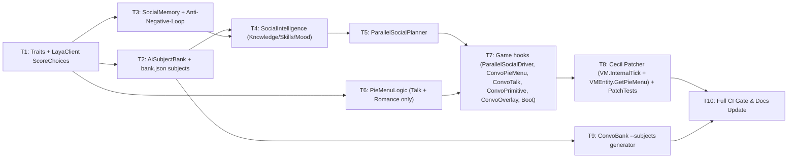

# Autonomous Parallel Room Social & AI-Only Talk/Romance Tasks

**Spec**: `.specs/features/autonomous-parallel-social/spec.md`
**Design**: `.specs/features/autonomous-parallel-social/design.md`
**Status**: Done

---

## Execution Plan

---

## Tasks

### Phase 1: Pure Logic Foundation

#### T1: Extend `RawSim` with Skills/Social/Relationships & Add `LayaClient.ScoreChoices`
- **Requirements**: APS-04, APS-06, APS-07
- **Where**: `Tools/Conversations/Logic/Traits.cs`, `Tools/Conversations/Logic/LayaClient.cs`, `Tools/Conversations.Tests/TraitsTests.cs`, `Tools/Conversations.Tests/LayaClientTests.cs`
- **Depends on**: none
- **Reuses**: existing `RawSim`, `TraitProfile`, `LayaClient`, `ILayaTransport`
- **Tests**: Unit tests (TDD) in `TraitsTests.cs` & `LayaClientTests.cs`
- **Done when**:
  - `RawSim` exposes `Social`, `Cooking`, `Charisma`, `Mechanical`, `Creativity`, `Body`, `Logic`, `NeighborId`, `StrToTarget`, `LtrToTarget`, `TargetStrToMe`, `TargetLtrToMe`, plus `SkillKind` enum, `SkillValue`, `TopSkills`, `SocialPercent`.
  - `LayaClient.ParseProbabilities` and `LayaClient.ScoreChoices` return full normalized probability maps, honor timeout/pause circuit breaker, and return `null` safely on errors/malformed JSON.
  - All existing + new unit tests pass (`dotnet test Tools/Conversations.Tests`).
- **Gate**: Quick (`dotnet test Tools/Conversations.Tests`)

#### T2: AI-Only Talk Subject Catalog (`AiSubjectBank` + `bank.json` Subjects)
- **Requirements**: APS-12
- **Where**: `Tools/Conversations/Logic/AiSubjectBank.cs`, `Tools/Conversations/Logic/DialogueBank.cs`, `Tools/Conversations/bank/bank.json`, `Tools/Conversations.Tests/AiSubjectBankTests.cs`
- **Depends on**: T1
- **Reuses**: `BankFile`, `DialogueBank.IsAcceptable`, `TopicLogic.Interests`, `LayaClient.ScoreChoices`
- **Tests**: Unit tests (TDD) in `AiSubjectBankTests.cs`
- **Done when**:
  - `BankFile` includes `Subjects` (`List<AiSubject>`).
  - `AiSubjectBank` loads validated AI subjects from `bank.json` and ships 48 built-in AI subjects across all 8 interest domains & 6 skills; rejects raw hardcoded TS1 labels (`"Travel and Toys"`, etc.).
  - `OfferForManualTalk` returns 3 distinct AI subjects ranked with Laya (or deterministic fallback) using speaker/listener interests, skills, and memory.
  - `bank.json` contains the 48 AI subjects and passes `DialogueBankTests` + `AiSubjectBankTests`.
- **Gate**: Quick (`dotnet test Tools/Conversations.Tests`)

#### T3: Per-Pair Social Memory & Anti-Negative-Loop Learning (`SocialMemory`)
- **Requirements**: APS-08, APS-09, APS-10
- **Where**: `Tools/Conversations/Logic/SocialMemory.cs`, `Tools/Conversations.Tests/SocialMemoryTests.cs`
- **Depends on**: T1
- **Reuses**: `RawSim`, `Tone`, `Newtonsoft.Json`
- **Tests**: Unit tests (TDD) in `SocialMemoryTests.cs`
- **Done when**:
  - Records interaction/tone/subject outcomes per directed pair `(speaker, listener)`.
  - Applies decaying penalty to recently failed interactions, tones, and subjects, and tracks discovered listener interests/skills.
  - Engages de-escalation mode at `NegativeStreak >= 2` (forbids `tease`/`brag`/`flirt`/`Bold`, boosts `apologize`/`talk`/`cheerup`/`compliment`/`Gentle`).
  - Engages cool-down backoff at `NegativeStreak >= 3` (`ShouldBackoff` returns true for backoff cycles).
  - Resets `NegativeStreak` and `BackoffRemaining` on positive outcomes (`quality == 3`).
  - JSON `Load`/`Save` round-trips cleanly and swallows missing/corrupt file errors.
- **Gate**: Quick (`dotnet test Tools/Conversations.Tests`)

#### T4: Social Intelligence (Knowledge, Skills & Mood Model) (`SocialIntelligence`)
- **Requirements**: APS-05, APS-06, APS-07
- **Where**: `Tools/Conversations/Logic/SocialIntelligence.cs`, `Tools/Conversations.Tests/SocialIntelligenceTests.cs`
- **Depends on**: T2, T3
- **Reuses**: `RawSim`, `TraitProfile`, `SkillKind`, `SocialMemory`, `AiSubject`
- **Tests**: Unit tests (TDD) in `SocialIntelligenceTests.cs`
- **Done when**:
  - Computes `Knowledge` (`0..1`) from LTR, STR, and `PairMemory.Exchanges`.
  - Computes `Accuracy` (`0.20..0.98`) from Knowledge, speaker Charisma, and speaker Mood.
  - Builds Laya context prompts that redact/blur listener temperament, interests, and skills when Knowledge is low and reveal them as Knowledge/Charisma/LearnedMemory grow.
  - Computes skill-affinity resonance bonus for shared/known skills and mood-based adjustment (bad speaker mood increases error/risk; perceived bad listener mood favors gentle/cheerup).
- **Gate**: Quick (`dotnet test Tools/Conversations.Tests`)

#### T5: Autonomous Parallel Social Planner (`ParallelSocialPlanner`)
- **Requirements**: APS-01, APS-02, APS-03, APS-04, APS-05, APS-06, APS-07, APS-08, APS-09
- **Where**: `Tools/Conversations/Logic/ParallelSocialPlanner.cs`, `Tools/Conversations.Tests/ParallelSocialPlannerTests.cs`
- **Depends on**: T4
- **Reuses**: `SocialIntelligence`, `SocialMemory`, `AiSubjectBank`, `LayaClient`, `OutcomeResolver`, `DialogueBank`
- **Tests**: Unit tests (TDD) in `ParallelSocialPlannerTests.cs`
- **Done when**:
  - `ShouldTriggerSocial(short socialMotive)` returns true iff `socialMotive <= 20` (`<= 60%`).
  - `IsSameRoom(roomA, isOutsideA, xA, yA, roomB, isOutsideB, xB, yB)` checks room equality indoors and room equality + `<= 8` tile distance outdoors.
  - `Plan(...)` uses Laya `ScoreChoices` to select interaction and (for `talk`) AI subject, modulated by Knowledge, Skills, Mood, and `SocialMemory` penalties / anti-negative-loop guard.
  - Evaluates outcome against listener's TRUE temperament/mood/interests/skills, computes Social motive and STR/LTR deltas, fills dialogue lines, and degrades gracefully when Laya is offline.
- **Gate**: Quick (`dotnet test Tools/Conversations.Tests`)

#### T6: Manual Pie Menu Filter (`PieMenuLogic`)
- **Requirements**: APS-11
- **Where**: `Tools/Conversations/Logic/PieMenuLogic.cs`, `Tools/Conversations.Tests/PieMenuLogicTests.cs`
- **Depends on**: T1
- **Reuses**: none (pure logic)
- **Tests**: Unit tests (TDD) in `PieMenuLogicTests.cs`
- **Done when**:
  - Filters adult-to-adult Sim pie menus to ONLY two top-level bubbles: `"Talk"` (single best Talk entry) and `"Romance/..."` (Flirt, Kiss, Romantic/Intimate/Leap-Into-Arms Hug, Back Rub, Slow/Romantic Dance, Propose).
  - Strips Friendly Hug, Joke, Brag, Compliment, Entertain, Tease, Insult, Slap, Scare, Tickle, Cheer Up, Apologize, Give Gift, Ask, etc.
  - Passes through untouched when disabled, self-target, child, pet, or when neither Talk nor Romance is present (e.g., ungreeted visitor with only `Greet`).
- **Gate**: Quick (`dotnet test Tools/Conversations.Tests`)

---

### Phase 2: Game Integration & Cecil Patching

#### T7: Game Hooks (`ParallelSocialDriver`, `ConvoPieMenu`, Updated `ConvoTalk`, `ConvoPrimitive`, `ConvoOverlay`, `Boot`)
- **Requirements**: APS-01, APS-02, APS-03, APS-08, APS-10, APS-11, APS-12, APS-13
- **Where**: `Tools/Conversations/Game/ParallelSocialDriver.cs`, `Tools/Conversations/Game/ConvoPieMenu.cs`, `Tools/Conversations/Game/ConvoTalk.cs`, `Tools/Conversations/Game/ConvoPrimitive.cs`, `Tools/Conversations/Game/ConvoOverlay.cs`, `Tools/Conversations/Game/Boot.cs`
- **Depends on**: T5, T6
- **Reuses**: existing `Boot`, `ConvoPrimitive`, `ConvoTalkPrimitive`, `ConvoOverlay`
- **Tests**: Release build verification (`dotnet build Tools/Conversations -c Release`) + existing `Conversations.Tests`
- **Done when**:
  - `Boot` exposes `OnTick(VM)`, `FilterPieMenu(List<VMPieMenuInteraction>, VMEntity, VM, VMEntity)`, loads/saves `SocialMemory` and `AiSubjectBank`, and adds `simtool convo memory | menu full|simple | parallel | trigger A B`.
  - `ParallelSocialDriver` runs off `VM.InternalTick`, never touches `VMThread.Queue`, dispatches planning on `ThreadPool`, drains results on VM tick to update Social/STR/LTR/Memory and show balloons.
  - `ConvoTalkPrimitive` offers 3 AI subjects from `Boot.Subjects` (never raw TS1 strings) and records outcome in `Boot.Memory`.
  - `ConvoPrimitive.Read` reads all 6 skills, Social motive, NeighborId, and STR/LTR; `Apply` records outcome in `Boot.Memory`.
  - `ConvoOverlay` supports concurrent room balloons cleanly.
  - `Early` still references zero game types.
- **Gate**: Build (`dotnet build Tools/Conversations -c Release -p:AppDir=<pristine>`)

#### T8: Cecil Patcher Hooks (`VM.InternalTick` + `VMEntity.GetPieMenu`) & Patch Integration Tests
- **Requirements**: APS-01, APS-11, APS-14
- **Where**: `Tools/SpriteCardsPatch/Program.cs`, `Tools/PatchTests/ConversationsPatchTests.cs`
- **Depends on**: T7
- **Reuses**: existing `SpriteCardsPatch` Cecil patching helpers and `ConversationsFixture`
- **Tests**: Integration/Patch tests (TDD) in `Tools/PatchTests/ConversationsPatchTests.cs`
- **Done when**:
  - `SpriteCardsPatch` patches `VM.InternalTick` to call `Boot.OnTick(this)` before every `ret`, and `VMEntity.GetPieMenu` to call `Boot.FilterPieMenu(list, this, vm, caller)` before every `ret`.
  - Both hooks are verified by new `ConversationsPatchTests` (signature resolution, IL structure, idempotency on second run).
- **Gate**: Full (`dotnet test Tools/PatchTests` with `SIMITONE_APP` set)

#### T9: Offline Subject Generation in `Tools/ConvoBank`
- **Requirements**: APS-12
- **Where**: `Tools/ConvoBank/Program.cs`, `Tools/ConvoBank/Prompts.cs`
- **Depends on**: T2
- **Reuses**: existing Ollama request/filter pipeline in `ConvoBank`
- **Tests**: Build verification (`dotnet build Tools/ConvoBank -c Release`)
- **Done when**:
  - `convobank --subjects` generates and validates AI talk subjects (`AiSubject` entries) into `bank.json` with `DialogueBank.IsAcceptable` and optional Laya filtering.
- **Gate**: Build (`dotnet build Tools/ConvoBank -c Release`)

#### T10: Full CI Gate, Documentation Update & Final Verification
- **Requirements**: APS-14
- **Where**: `Tools/Conversations/README.md`, `.specs/features/autonomous-parallel-social/tasks.md`
- **Depends on**: T8, T9
- **Reuses**: `Tools/ci.ps1`
- **Tests**: Full CI (`pwsh Tools/ci.ps1 -App <pristine>`)
- **Done when**:
  - `Tools/ci.ps1` passes 100% (all builds, `SpriteCards.Tests`, `Conversations.Tests`, `PatchTests`, `InputHookPatch` smoke, `ButtonHoverPatch` smoke).
  - `Tools/Conversations/README.md` documents parallel room social, memory, AI-only talk subjects, simplified Talk/Romance menu, and new `simtool convo` subcommands.
- **Gate**: Full (`pwsh Tools/ci.ps1`)

---

## Pre-Execution Validation Tables

### Diagram-Definition Cross-Check

| Task | Diagram Parents | `Depends on` Field | Match? |
| --- | --- | --- | --- |
| T1 | none | none | ✅ |
| T2 | T1 | T1 | ✅ |
| T3 | T1 | T1 | ✅ |
| T4 | T2, T3 | T2, T3 | ✅ |
| T5 | T4 | T4 | ✅ |
| T6 | T1 | T1 | ✅ |
| T7 | T5, T6 | T5, T6 | ✅ |
| T8 | T7 | T7 | ✅ |
| T9 | T2 | T2 | ✅ |
| T10 | T8, T9 | T8, T9 | ✅ |

### Test Co-location Validation

| Task | Code Layer | Required Tests | Co-located in Task? | Gate |
| --- | --- | --- | --- | --- |
| T1 | `Logic/` | Unit (`TraitsTests`, `LayaClientTests`) | ✅ | Quick |
| T2 | `Logic/` + `bank.json` | Unit (`AiSubjectBankTests`) | ✅ | Quick |
| T3 | `Logic/` | Unit (`SocialMemoryTests`) | ✅ | Quick |
| T4 | `Logic/` | Unit (`SocialIntelligenceTests`) | ✅ | Quick |
| T5 | `Logic/` | Unit (`ParallelSocialPlannerTests`) | ✅ | Quick |
| T6 | `Logic/` | Unit (`PieMenuLogicTests`) | ✅ | Quick |
| T7 | `Game/` | Build + existing unit tests | ✅ | Build |
| T8 | `SpriteCardsPatch` | Integration (`PatchTests`) | ✅ | Full |
| T9 | `ConvoBank` | Build | ✅ | Build |
| T10 | CI + Docs | Full CI (`ci.ps1`) | ✅ | Full |
