# Custom 3D Skeletal Animation System Design

**Spec:** `.specs/features/custom-animations/spec.md`  
**Research:** `.specs/features/custom-animations/research.md`  
**Status:** Draft (Pending User Approval)

---

## Architecture Overview

We separate the system into **three cleanly decoupled layers** following Project Architecture Decision **AD-002** (Pure Logic in `Tools/Conversations/Logic/` tested on `net9.0`, Thin MonoGame/Vitaboy glue in `Tools/Conversations/Game/`, and Offline Asset Pipeline in `Tools/AnimPipeline/`):

```mermaid
flowchart LR
    subgraph Offline["Offline Authoring & Retargeting (Tools/AnimPipeline)"]
        FAR["TS1 Animation.far\nadult-skeleton.cmx.bcf"] --> DUMP["dump_adult_skel.py\n-> adult_skel_ref.json"]
        BVH["CC-BY BVH Mocap\n100STYLE / ACCAD / CMU"] --> RETARGET["bvh_to_simanim.py\nGlobal-Delta Retargeter"]
        DUMP --> RETARGET
        DUMP --> BLEND["blender_rig_setup.py\nBlender 4.5 IK Rig (.blend)"]
        BLEND --> BEXP["blender_export_simanim.py\nHeadless bpy Exporter"]
        RETARGET --> CLIPS["Content/CustomAnims/*.simanim.json"]
        BEXP --> CLIPS
    end

    subgraph PureLogic["Pure C# Runtime (Tools/Conversations/Logic — net9.0 tested)"]
        CLIPS --> LOADER["CustomAnimClip & CustomAnimLoader\nJSON parse, normalize, hemisphere fix"]
        LOADER --> EVAL["CustomAnimEvaluator\nWrap-safe SQUAD / SLERP + CatmullRom"]
        EVAL --> BLENDR["CustomAnimBlender\nCrossfade + Upper/Lower SPINE Mask"]
        BLENDR --> IK["TwoBoneIkSolver (P3)\nAnalytical Law of Cosines"]
    end

    subgraph GameBridge["Thin Vitaboy Bridge (Tools/Conversations/Game — net461)"]
        IK --> PLAYER["VitaboyClipPlayer\nWrites Skeleton.Bones + ReloadSkeleton()"]
        PLAYER --> CADET["CadetAcademySceneRenderer\n& Future Rank 3-10 Renderers"]
        PLAYER --> PREVIEW["AnimPreviewOverlay (P2)\nconvo anim preview / reload"]
        LOADER --> ADAPTER["VitaboyAnimationAdapter (P3)\n-> FSO.Vitaboy.Animation for VMAvatar"]
    end
```



---

## Data Model: `.simanim.json` Clip Schema (v1)

Human-readable, diffable, hot-reloadable JSON stored in `Tools/Conversations/Assets/Animations/` and deployed to `<SimitoneApp>/CustomAnims/` by `Install-Conversations.ps1`. All bone transforms are stored directly in **FreeSO/MonoGame right-handed `adult.skel` local bone space** so runtime playback requires **zero coordinate conversions per frame**.

```json
{
  "version": 1,
  "name": "cadet_sprint_loop",
  "skeleton": "adult",
  "fps": 30,
  "frameCount": 20,
  "duration": 0.6667,
  "loop": true,
  "mask": "full",
  "rootSpeedUnitsPerSec": 10.2,
  "source": "retargeted:100style/Run_FW (CC-BY-4.0)",
  "events": [
    { "frame": 4,  "name": "footstep_l", "value": "1" },
    { "frame": 14, "name": "footstep_r", "value": "1" }
  ],
  "handGestures": [
    { "frame": 0, "left": "Fist", "right": "Fist" }
  ],
  "tracks": [
    {
      "bone": "ROOT",
      "translations": [[0.0, 2.86, 0.0], "..."],
      "rotations": [[0.0, 0.7071, 0.0, 0.7071], "..."]
    },
    {
      "bone": "SPINE",
      "rotations": [[0.0, 0.14, 0.0, 0.99], "..."]
    }
  ]
}
```

### Schema Design Choices
- **Dense uniform-FPS arrays OR sparse keyed timestamps?** Support **uniform-FPS dense arrays** (`frameCount` samples at `fps`, e.g., 30 fps) as primary for retargeted BVH & baked Blender clips (zero binary search, `O(1)` frame indexing, tiny: 20 frames × 29 bones ≈ ~18 KB uncompressed JSON), AND optional sparse `times[]` array per track for hand-tuned stylized clips.
- **`mask` hint:** `"full"`, `"upper"` (`SPINE` and descendants), or `"lower"` (`ROOT`, `PELVIS`, legs/feet). Runtime callers can also override the mask per layer.
- **`rootSpeedUnitsPerSec`:** In **Vitaboy skeleton units/sec** (so multiplying by `SimScale`, e.g. `0.60`, gives the exact world-space speed at which boots remain 100% planted with zero skating!).

---

## Coordinate-Space & Retargeting Math (Verified Against `Skeleton.cs`)

### 1. FreeSO `adult.skel` FK Convention (`Skeleton.cs:204-215`)
MonoGame uses **row vectors**:
$$M_i^{\text{world}} = \big(R(q_i) \cdot T(t_i)\big) \cdot M_{\text{parent}(i)}^{\text{world}}$$
where $q_i = (x, y, z, w)$ is the bone's local quaternion and $t_i$ is its local offset in parent space.
- World `+Y` = Up, `+Z` = Sim Forward, `+X` = Sim Left.
- Every bone's rest vector extends along local `-X`.
- `adult.skel` rest pose has arms hanging **down** (A-pose), NOT T-pose.

### 2. Global-Space Delta Retargeting (BVH → `adult.skel`)
Given:
- Source BVH bone world rotation at rest T-pose $R^S_i$ (identity for standard BVH) and animated frame $A^S_i$ (converted from BVH RH Y-up — note: BVH `+Z` forward, `+Y` up, `+X` character-left matches MonoGame RH directly!).
- Target `adult.skel` world rotation posed in a **matching visual T-pose** $R^T_{\text{ref},i}$ (precomputed once in `adult_skel_ref.json` by rotating `L_ARM1`/`R_ARM1` outward ~82° from A-pose to horizontal T-pose!).

Then top-down from `ROOT` to leaves:
$$A^T_i = \underbrace{\big(A^S_i \cdot (R^S_i)^{-1}\big)}_{\Delta_{\text{world}, i}} \cdot R^T_{\text{ref}, i}$$
and converting back to FreeSO row-vector local rotation ($A^T_i = a^T_i \cdot A^T_p$ in row-vector matrix form, i.e. $M_{\text{local}} = M_{\text{world}} \cdot (M_{\text{parent}})^{-1}$):
$$a^T_i = A^T_i \cdot (A^T_p)^{-1}$$

*(Note: Python unit tests will explicitly verify that running forward kinematics with the retargeted `a^T_i` reproduces `A^T_i` within `1e-5` error!)*

### 3. Root Translation & Foot Grounding
- Keep `ROOT` in-place along forward axis (`Z = 0`) for looping locomotion clips, while extracting average forward delta per second into `rootSpeedUnitsPerSec`!
- Scale vertical hip bob & lateral sway by hip-height ratio $s = h_{\text{adult}} / h_{\text{source}}$ (`h_adult = 3.014`).
- Per frame, compute FK world `Y` of `L_TOE0`, `R_TOE0`, `L_FOOT`, `R_FOOT` and shift `ROOT.Y` if needed (or clamp penetration below `Y = 0`) so boots kiss the floor cleanly on stance phases without floating or sinking.

### 4. Blender 4.5 (`bpy`) → FreeSO Conversion
Blender is **right-handed Z-up** (`+X` right, `+Y` back/forward, `+Z` up). Our `blender_rig_setup.py` builds the 29-bone armature directly from `adult_skel_ref.json` using the exact basis change matrix $B = R_X(+90^\circ)$ (`(x, y, z)_MG -> (x, -z, y)_Blender`), and `blender_export_simanim.py` applies $B^{-1}$ to each evaluated pose bone's world matrix, then extracts `M_local = M_world * inv(M_parent)` in MonoGame row-vector space — guaranteeing **exact 1:1 visual parity** between Blender's viewport and Simitone!

---

## Code Reuse Analysis

| Existing Component | Location | How We Reuse It |
|---|---|---|
| Pure Logic / Thin Game split (AD-002) | `Tools/Conversations/Logic/` + `Tools/Conversations.Tests/` | All math structs (`Vec3`, `Quat`), JSON parsing, SQUAD/SLERP, crossfade blending, bone masks, and 2-bone IK live in `Logic/` with zero `FSO.*`/`Xna.*` dependencies so they compile and run in `<100ms` under `net9.0` xUnit! |
| `CadetAcademySceneRenderer` | `Tools/Conversations/Game/CadetAcademySceneRenderer.cs` | Replace raw `Animator.RenderFrame` calls with `VitaboyClipPlayer.EvaluateAndApply(cadetAvatar, dt)` while keeping all uniform resolution, 3D academy geometry, lighting, and camera code intact. |
| `Install-Conversations.ps1` | `Tools/Install-Conversations.ps1` | Extend deployment step to copy `Tools/Conversations/Assets/Animations/*.simanim.json` into `<App>/CustomAnims/`. |
| Pipe debug dispatcher (`ConvoCommand`) | `Tools/Conversations/Game/Boot.cs` | Add `convo anim preview <clip>` and `convo anim reload` following the exact `convo dispatch ...` command pattern. |

---

## Component Breakdown

### 1. `Tools/Conversations/Logic/CustomAnimModel.cs`
- **Purpose:** Pure-C# math primitives (`AnimVec3`, `AnimQuat` with `Normalize`, `Dot`, `Slerp`, `Squad`, `Multiply`, `Conjugate`) and clip data structures (`CustomAnimClip`, `CustomBoneTrack`, `CustomAnimEvent`, `CustomHandCue`, `AnimBoneMask`).
- **Dependencies:** `System` only (`net461` + `net9.0` compatible).

### 2. `Tools/Conversations/Logic/CustomAnimLoader.cs`
- **Purpose:** Lightweight zero-dependency JSON parser/serializer for `.simanim.json` (matching existing `Logic/` pattern — no extra NuGet packages needed in `net461`), performing quaternion normalization and adjacent-frame hemisphere sign alignment on load.
- **Interfaces:** `CustomAnimClip ParseJson(string json)`, `string ToJson(CustomAnimClip clip)`, `CustomAnimClip LoadFromFile(string path)`.

### 3. `Tools/Conversations/Logic/CustomAnimBlender.cs`
- **Purpose:** Stateful multi-layer animation controller supporting:
  - Wrap-safe frame evaluation (`EvaluateTrack` with `Loop` wrap `frameCount - 1 -> 0`, optional SQUAD cubic quaternion smoothing),
  - Smooth crossfade stack (`Play(clip, fadeSeconds, speed, loop)`),
  - Upper/lower-body masked overlay (`SetOverlay(clip, mask, weight, fadeSeconds)`),
  - Event firing callbacks (`FiredEvents` list per `Tick(dt)`),
  - Root-motion displacement output (`LastStepForwardUnits`).

### 4. `Tools/Conversations/Game/VitaboyClipPlayer.cs`
- **Purpose:** Thin MonoGame/Vitaboy bridge applying `CustomAnimBlender`'s evaluated `BonePose[29]` onto `SimAvatar.Skeleton.Bones`, updating `LeftHandGesture`/`RightHandGesture`, and calling `ReloadSkeleton()`.
- **Hot-reload cache:** `CustomAnimLibrary.Get(name)` caches clips from `<App>/CustomAnims/` and supports `ReloadAll()` for live iteration.

### 5. `Tools/AnimPipeline/` (Offline Python 3.11 + Blender 4.5 Scripts)
- `dump_adult_skel.py` — Reads `adult-skeleton.cmx.bcf` from `Animation.far` → writes `adult_skel_ref.json` (29 bones + rest pose + T-pose reference).
- `bvh_to_simanim.py` — Offline BVH parser + Global-Space Delta Quaternion retargeter + floor grounding + stride-speed extractor → `.simanim.json`.
- `blender_rig_setup.py` — Headless Blender 4.5 script building `adult_rig.blend` with IK constraints & bone collections.
- `blender_export_simanim.py` — Headless Blender 4.5 exporter sampling any Action → `.simanim.json` with exact basis conversion.
- `generate_cadet_pack.py` — Reproducible build script that produces our 6 Cadet Academy `.simanim.json` clips (combining retargeted CC-BY BVH locomotion + Blender-authored tactical/drill Actions) so every clip can be tweaked and regenerated deterministically!

### 6. `Tools/Conversations/Logic/TwoBoneIkSolver.cs` (P3) & `Game/VitaboyAnimationAdapter.cs` (P3)
- Analytical 2-bone limb IK (Law of Cosines + pole vector) for precise target pointing / foot pinning.
- Runtime converter `CustomAnimClip -> FSO.Vitaboy.Animation` for playing custom clips directly inside `VMAvatar` on the live lot.

---

## Error Handling Strategy

| Error Scenario | Handling | User Impact |
|---|---|---|
| `CustomAnims/` folder missing or clip file deleted | `CustomAnimLibrary.TryGet()` returns `null`, logs once to `Boot.Log`, renderer falls back to vanilla TS1 `Animation.far` clip | Game continues seamlessly with zero crash |
| Corrupt/malformed `.simanim.json` during live hot-reload | `CustomAnimLoader.ParseJson()` catches parse error, preserves previously loaded valid clip, reports error in pipe response | Preview stays alive; developer sees exact parse error |
| Unnormalized / zero-length quaternion in JSON | Replaced with `BaseSkeleton` rest rotation (or identity) on load | Prevents NaN vertex explosions in GPU skinning shader |
| Unknown bone name in clip track | Ignored safely during evaluation | Forward-compatible across rig revisions |

---

## Key Technical Decisions

| Decision | Choice | Rationale |
|---|---|---|
| **Clip format** | Custom `.simanim.json` (not `.bcf`/`.cfp`) | Zero quantization loss (unlike TS1 `.cfp` delta table), supports `rootSpeedUnitsPerSec`, `mask`, hand gestures, human-diffable, hot-reloadable, and requires zero FreeSO DLL patches. |
| **Where math lives** | `Tools/Conversations/Logic/` (`AnimVec3`/`AnimQuat`) | Follows AD-002; allows full `net9.0` xUnit testing of SQUAD, crossfade, masking, and IK in `<100ms` without MonoGame DLLs. |
| **Motion sourcing** | Hybrid: CC-BY BVH (100STYLE/ACCAD/CMU) + Blender 4.5 procedural/keyframed Actions | 100% offline, legally clean for open repos, gives real athletic kinematics for Sprint/Vault AND crisp stylized Sims charm for Aim/Salute/Radio/Ticket. |
| **No `simPitch` hack** | Encode forward athletic torso lean inside `PELVIS`/`SPINE` tracks | Tilting the whole `SimAvatar.RotationX` lifts one foot and buries the other; proper spine lean keeps boots flat on the track! |
