[Latest Pre-release](https://github.com/riperiperi/Simitone/releases/latest/) | [Download](https://github.com/riperiperi/Simitone/releases/latest/download/SimitoneWindows.zip)

Alternative C# Windows Frontend for The Sims 1, based off of FreeSO. http://freeso.org 
(***REQUIRES*** a legitimate copy of The Sims: Complete Collection)

NOTE! Currently does not support the entire Fame career track, saving on vacation and a few other important things. While all objects run, many of them have bugs that can make certain lot types unplayable. For current development progress, see [this issue.](https://github.com/riperiperi/Simitone/issues/8)

*Only for Desktop Windows.* Other platforms cannot be officially supported.

# Purpose

On modern operating systems, The Sims has a few nagging issues that make it less than playable. Simitone can be seen as a tool to improve the playability of your existing installation of The Sims. Here are some features:

- Playable in 3D - using a combination of models generated from the 2D sprites and created by the community.
  - [Download the mesh pack here!](http://forum.freeso.org/forums/3d-remeshing.40/)
- Custom user interface that works at modern resolutions. Working on a more desktop oriented interface.
- Improved graphical performance, support for high resolutions and refresh rates.
- Custom lighting - directional lights with smooth falloffs and shadows using generated 3D meshes.
- *Volcanic*, a program which allows you to examine, modify and create new game objects. (from FreeSO)

# AI Conversations & Sim Memory Mod

This fork includes an optional **AI Conversations & Sim Memory** mod (`Tools/Conversations`) powered by a bundled local [Laya](https://github.com/laya-ai) model (runs offline on CPU, no live LLM at play time):

- **Autonomous parallel room conversations:** awake adult Sims in the same room automatically chat with each other **without interrupting their ongoing activities** whenever their Social need drops to `<= 60%`.
- **Laya-driven social intelligence:** chooses verbal interactions and AI talk subjects based on each Sim's knowledge of the listener, skills (Charisma, Cooking, Mechanical, Creativity, Logic, Body), moods, and past social history.
- **Per-Sim Social Memory & floating dossier window:** every conversation records what a Sim has learned about each Sim they know — **Daily / Lifetime** relationship, familiarity %, revealed personality traits, observed temperament, career, liked/disliked interests, discovered skills, and discussed topics — accessible from the **Sim Memory** button in the selected Sim's Live-mode panel (right alongside Needs, Career, Personality, Relationships, and Inventory).
- **Simplified manual pie menu & 100% AI Talk subjects:** clicking another adult Sim shows **Talk** and **Romance** only; Talk presents 3 Laya-ranked AI subjects rather than raw legacy interest labels.
- **Easy toggle:** enable or disable the entire mod anytime via **Options -> AI conversations** (green = on).

See [Tools/Conversations/README.md](Tools/Conversations/README.md) for architecture, Laya bundling, and installation instructions (`pwsh Tools/Install-Conversations.ps1`).

## Screenshots

### 1. Simplified Manual Pie Menu (Talk & Romance)

### 2. AI Talk Subject Chooser

### 3. Live Over-Head Speech Balloons

### 4. Autonomous Parallel Room Conversations

### 5. Selected Sim Live Panel — Sim Memory Button
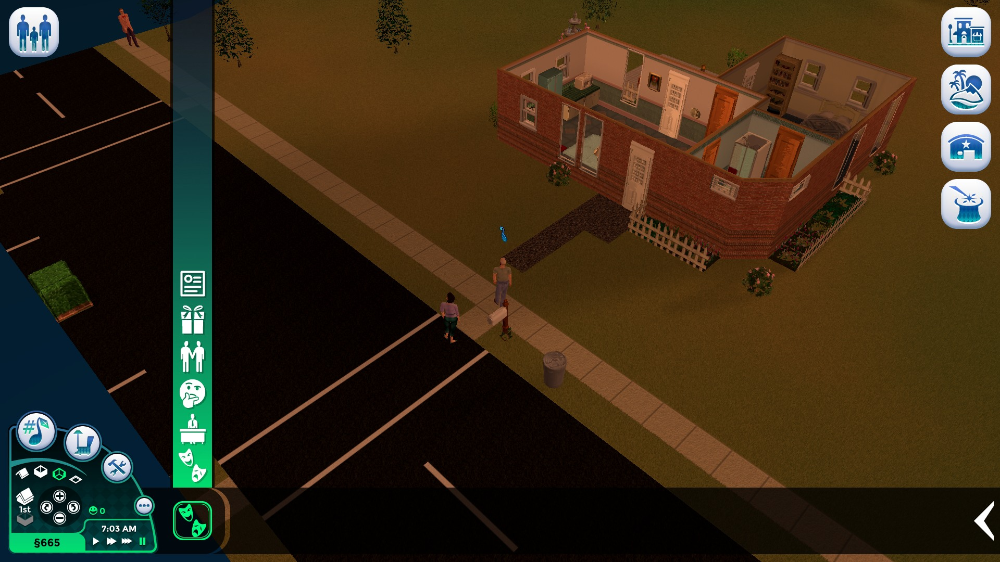

### 6. Floating Sim Memory Dossier Window

# Interactive Career Mini-Games (Radio Dispatch & Virtual Pocket Lots)

Built into the same `Tools/Conversations` mod, **Interactive Career Mini-Games** turn passive off-lot work hours into optional, playable mid-shift assignments that award real in-game Simoleons, Job Performance, Skill XP, and Motive boosts without interrupting multi-Sim household play.

## How Career Mini-Games Work

1. **Non-Blocking Radio Dispatch Toast:** While an active-family Sim is away at work (once per Sim per work day), a pulsing top-right radio dispatch toast (`CH-04 LAW ENFORCEMENT`) appears for 30 seconds. Click **ANSWER DISPATCH** to play, or **IGNORE** (or let it expire) with zero penalty.
2. **Home Lot Safely Paused:** Answering a dispatch pauses the live lot VM (`SpeedMultiplier = 0`) and launches that rank's registered mini-game via the multi-rank `CareerDispatchRegistry` router.
3. **Full-Screen "Virtual Pocket Lot" Pattern (Level 2+):** Instead of triggering a slow TS1 lot reload, newer shifts fade smoothly into a dedicated full-screen 3D venue (`RenderTarget2D` + `VirtualLotTransition`) starring your actual 3D Sim in their authentic TS1 career uniform, custom Blender-authored `.simanim.json` skeletal animations, sideline NPCs, and procedural sound effects — then fade cleanly back to your paused home lot.
4. **Real SimAntics Rewards:** Finishing a shift shows an `S` / `A` / `B` / `C` scorecard and writes real rewards straight into the VM: **Bonus Simoleons** (`CurrentFamily.Budget`), **Job Performance**, **Skill XP** (e.g. Body / Logic / Charisma), and **Motives** (`Fun`, `Energy`).

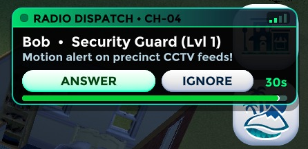

## Career & Rank Matrix

### Law Enforcement Career (Active Track)

| Level | Rank Title | Mini-Game | Gameplay & Presentation | Status |
| :---: | :--- | :--- | :--- | :---: |
| **1** | **Security Guard** | **CCTV Night Watch** | 4-camera night-vision CRT desk monitor (5 rounds): spot 3D threats (`Burglar`, `Vandal`, `Prowler`) vs. false alarms (`Raccoon`, `Stray Cat`, `Pizza Delivery`), manage `Stay Awake` alertness (`Energy` + 3 `Sip Coffee` charges), eerie procedural booth hum & alarms. | **Playable** |
| **2** | **Cadet** | **Academy Obstacle & Drill** | Full-screen 3D **Virtual Pocket Lot** (*SimCity Police Academy*): 3 timing stages (**Sprint Dash → Wall Vault → Target Drill**), **Body** skill widens the green hit zone, custom 3D animations, authentic TS1 career uniforms, Sideline Drill Sergeant, and 18 procedural Police Academy SFX + outdoor ambience. | **Playable** |
| **3** | **Patrol Officer** | **Real-Lot Live Beat Patrol** | Patrols real Sims 1 **Downtown (`House21–30`)**, **Old Town (`House50–78`)**, and **Neighbor Residential (`House01–10`)** lots with a parked TS1 **Police Squad Car** at the street curb: survey the live lot, use native Simitone **Pie Menus** on suspects & hazards, **Sneak Up & Apprehend** the prowling TS1 Burglar with custom Blender stealth animations, issue friendly warnings/tickets to real townies (saving real relationship & Sim Memory deltas), and return seamlessly to your saved home lot. | **Playable** |
| **4** | **Desk Sergeant** | **911 Dispatch Triage** | Multi-call incoming emergency queue (`Cat in Tree`, `Burglar Alarm`, `Kitchen Fire`, `Prank Call`); route to **Patrol / Fire / Ignore** before queue overflow. | **Next Up (Planned)** |
| **5** | **Vice Squad** | **Undercover Sting (Laya Social)** | 3-turn undercover conversation powered by **Laya + Charisma**; pick Gentle / Playful / Bold cover lines to keep Suspicion low until confession and record intel in **Sim Memory**. | Planned |
| **6** | **Detective** | **Crime Scene Deduction** | Evidence board with 3 clues (`Footprint`, `Motive`, `Alibi`) and 3 real neighborhood Sims as suspects; **Logic** flags contradictions; unlocks on-lot **Question Sim**. | Planned |
| **7** | **Lieutenant** | **Precinct Squad Briefing** | Assign 3 rookie officers (*Fast*, *Observant*, *Charming*) to 3 city incidents (`Foot Chase`, `Stakeout`, `Community Mediation`). | Planned |
| **8** | **SWAT Team Leader** | **Tactical Breach Plan** | 4×4 room grid with doors, suspects, and hostages; sequence 3 entry moves (`Flashbang`, `Shield`, `Quiet Entry`) for zero collateral damage. | Planned |
| **9** | **Police Chief** | **City Hall Press Conference & Budget** | Allocate precinct budget across Patrols, Forensics, and Outreach, then answer Laya-judged press questions to boost City Approval. | Planned |
| **10** | **Captain Hero** | **City Crisis Rescue** | Multi-emergency SimCity map (`Runaway Trolley`, `Llama Heist`, `Giant Robot`) with rapid **Strength / Wit / Inspiration** rescues; unlocks on-lot **Heroic Pose**. | Planned |

### Other Sims 1 Careers

Once Law Enforcement establishes the full suite of mini-game templates (CRT console, full-screen 3D Virtual Pocket Lot, real-lot live patrol, Laya social investigation, triage/strategy boards), the same `CareerDispatchRegistry` pipeline is designed to expand to **Criminal**, **Military**, **Science**, **Medicine**, **Politics**, **Business**, **Entertainment**, **Pro Athlete**, and **X-Treme**.

---

## Playable Mini-Games Showcase

### Law Enforcement Lvl 1 — Security Guard: *CCTV Night Watch*

Watch four live-lit 3D night-vision camera feeds (`Front Gate`, `Loading Dock`, `East Alley`, `Rooftop`) across five timed rounds. Sound the alarm on real intruders (`Burglar`, `Vandal`, `Prowler`), clear harmless visitors (`Raccoon`, `Stray Cat`, `Pizza Delivery`), and sip coffee to keep your Sim's alertness up until morning.

- **Gameplay Video:** [Watch Lvl 1 — CCTV Night Watch Demo (MP4)](docs/career-minigames/media/lvl1-security-guard-cctv-demo.mp4)

| Live 3D Night-Vision CRT Feed (Burglar Alert) | Shift Report & Real VM Rewards |
| :---: | :---: |
| 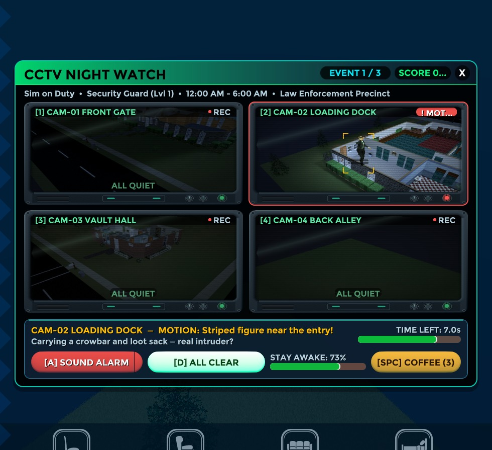 | 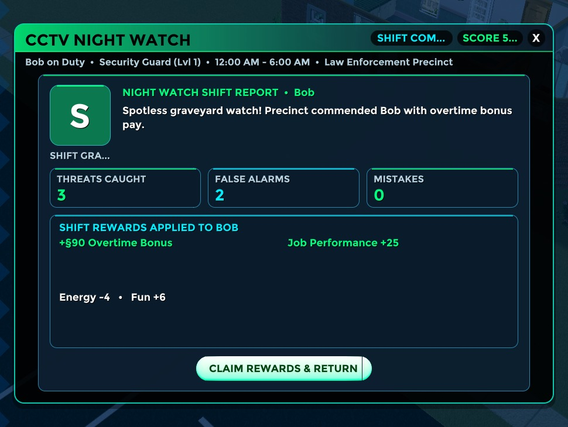 |

---

### Law Enforcement Lvl 2 — Cadet: *Academy Obstacle & Drill*

Step straight into a full-screen 3D **SimCity Police Academy — Training Grounds** Virtual Pocket Lot featuring a sunlit terracotta track, hurdles, brick-and-timber vault wall, steel bullseye firing range, precinct building, bleachers, parked patrol cruisers with pulsing lightbars, and your **Sideline Drill Sergeant** (wearing the authentic TS1 Police Officer cap & senior uniform).

- **Custom 3D Animations:** Powered by our pure-C# `.simanim.json` skeletal runtime (`VitaboyClipPlayer` + `TwoBoneIkSolver`) with 7 Blender-authored clips (`cadet_idle_attention`, `cadet_sprint_loop`, `cadet_hurdle_hop`, `cadet_wall_vault`, `cadet_target_aim_loop`, `cadet_target_fire_recoil`, `cadet_victory_salute`).
- **Action-Synced Police Academy Audio:** 18 procedural SFX cues (`CadetAudioSynth` + `CadetAcademyAudioEngine`) — arrival radio/bugle, outdoor grounds breeze & birds, Drill Sergeant pea-whistle, cadence-matched track footsteps, hurdle-hop & vault whooshes, mat landing / wall-clip thud, tactical range gunshot + delayed steel bullseye gong, hit stings, snare + brass Victory Fanfare, and return-home chime.
- **Gameplay Video (1280×720 HD with Synced Audio):** [Watch Lvl 2 — Cadet Academy Demo (MP4)](docs/career-minigames/media/lvl2-cadet-academy-demo.mp4)

| Briefing & Drill Sergeant at Starting Line | Officer & Drill Sergeant Close-Up |
| :---: | :---: |
| 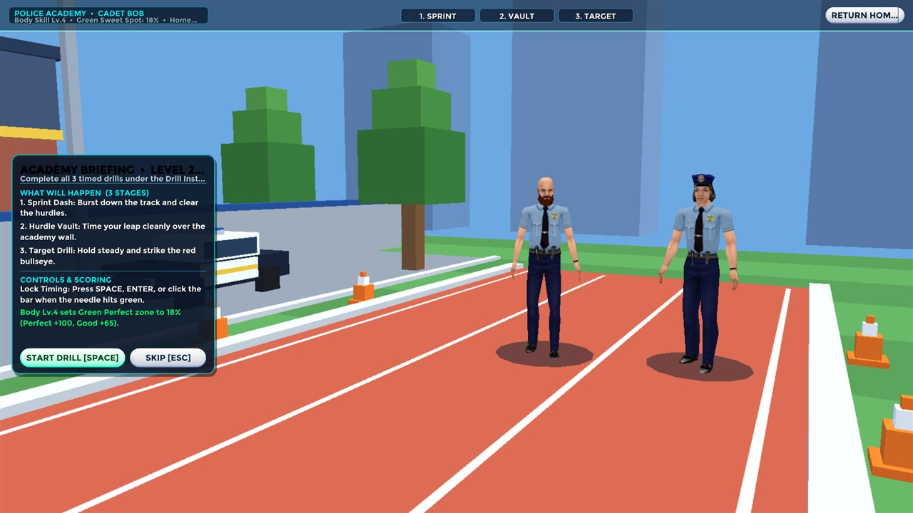 | 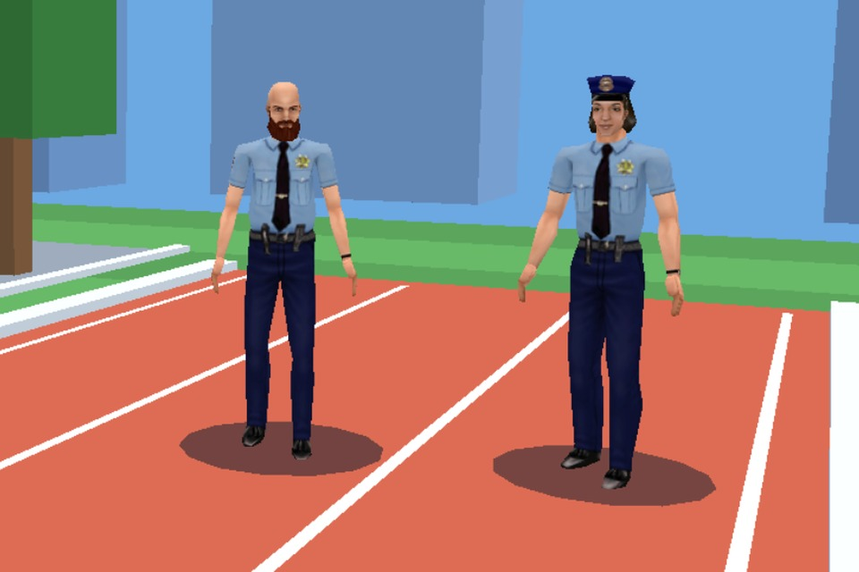 |

| Stage 1 — Sprint Dash & Hurdles | Stage 2 — Parkour Wall Vault |
| :---: | :---: |
| 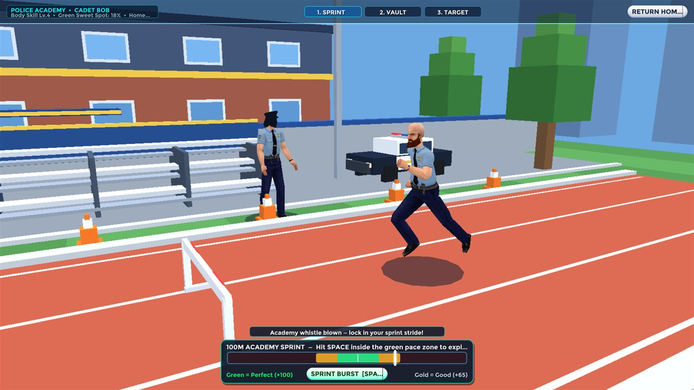 | 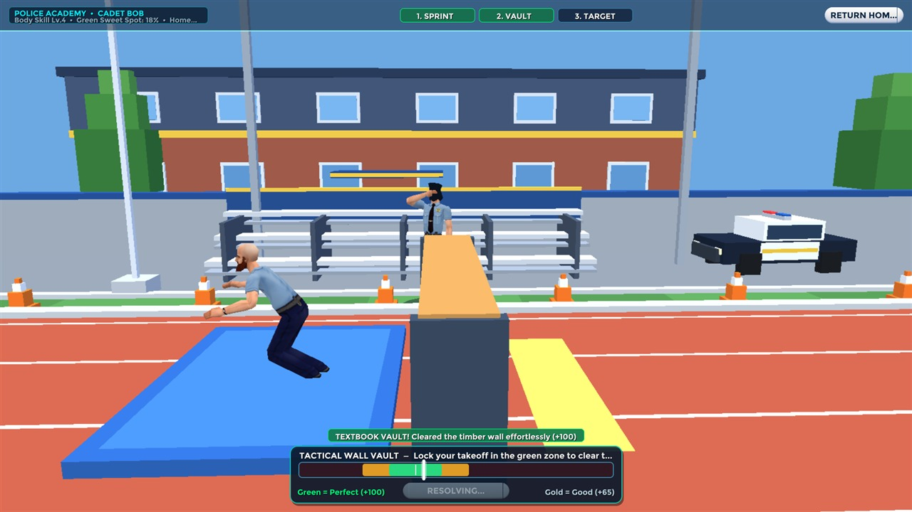 |

| Stage 3 — Precision Target Drill | S-Rank Scorecard & Synchronized Temple Salute |
| :---: | :---: |
| 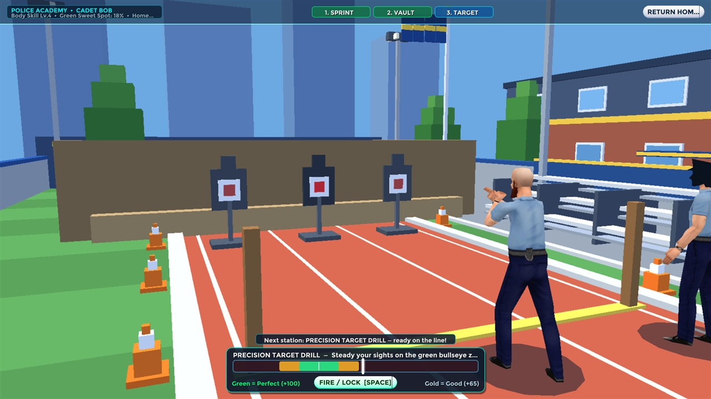 | 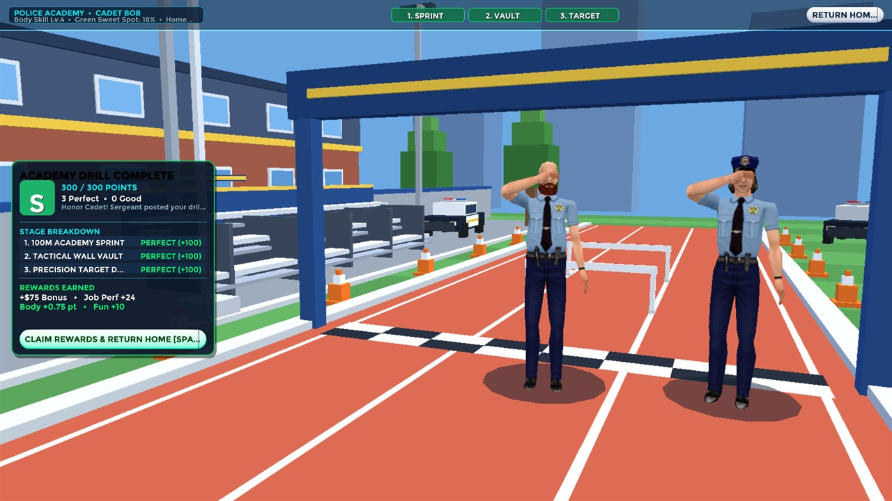 |

---

### Law Enforcement Lvl 3 — Patrol Officer: *Real-Lot Live Beat Patrol*

Patrol **actual Sims 1 lots** across **Downtown (`House21–30`)**, **Old Town (`House50–78`)**, and **Neighbor Residential lots (`House01–10`)** in warm golden-hour lighting — without overwriting your saved home lot. Your Officer arrives inside a real TS1 **Police Squad Car** (`CarSquad.iff`) parked at the street curb while you pan and zoom the live lot to spot incidents and click suspects or hazards for native Simitone **Pie Menus**:

- **Stealth Burglar Apprehension & Cruiser Escort:** Select **`Sneak Up & Apprehend`** on the prowling striped TS1 Burglar to step out of the cruiser and drive our custom Blender-baked crouched stealth cycle (`patrol_sneak_loop.simanim.json`) right up behind them, followed by `patrol_apprehend.simanim.json`, handcuff clicks, live overhead speech balloons, and a full **handcuffed escort walk back to the parked Police Squad Car** (`patrol_cuffed_walk_loop` + `patrol_escort_walk_loop`) where the officer opens the rear door, loads the burglar inside, and shuts the cruiser door before continuing patrol.
- **Real Neighborhood Townies & Civic Hazards:** Resolve a **Noise Disturbance** (`Friendly Warning` or `Issue Citation` to a real townie with a Boombox — saving real TS1 relationship & Sim Memory deltas), inspect & log a **Civic Hazard** (`patrol_inspect_clue.simanim.json`), and avoid falsely ticketing innocent citizens.
- **Custom 3D Patrol Animations & 17 Procedural Audio Cues:** 6 Blender-authored patrol clips (`patrol_sneak_loop`, `patrol_apprehend`, `patrol_write_ticket`, `patrol_inspect_clue`, `patrol_cuffed_walk_loop`, `patrol_escort_walk_loop`) + `PatrolAudioSynth` (city dusk ambience, cruiser arrival siren blip, car doors, stealth footsteps, handcuffs, ticket rip, flashlight click, radio squelch, and shift fanfare).
- **Gameplay Video (HD with Synced Beat Patrol Audio):** [Watch Lvl 3 — Real-Lot Live Beat Patrol Demo (MP4)](docs/career-minigames/media/lvl3-patrol-officer-reallot-demo.mp4)

| Parked TS1 Police Squad Car & Briefing (Lot 21) | Live Crouched Sneak-Up (`patrol_sneak_loop`) |
| :---: | :---: |
| 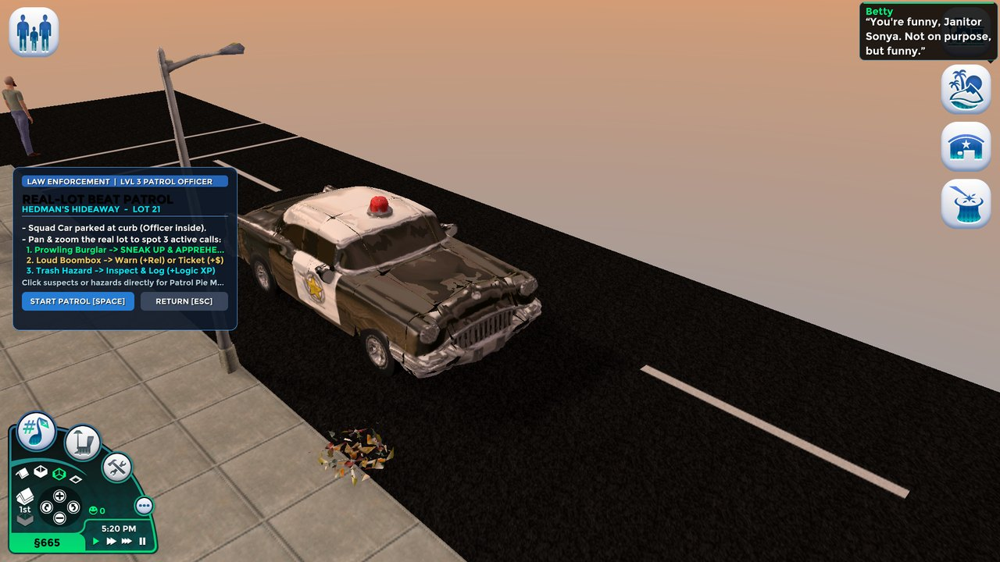 | 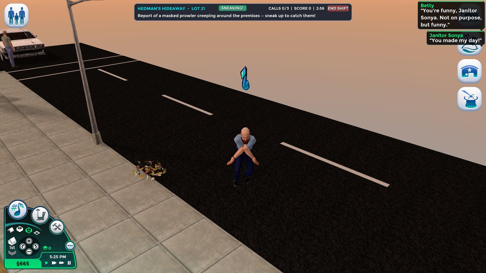 |

| Burglar Apprehension & Overhead Speech Balloons | Handcuffed Escort Back to Police Car |
| :---: | :---: |
| 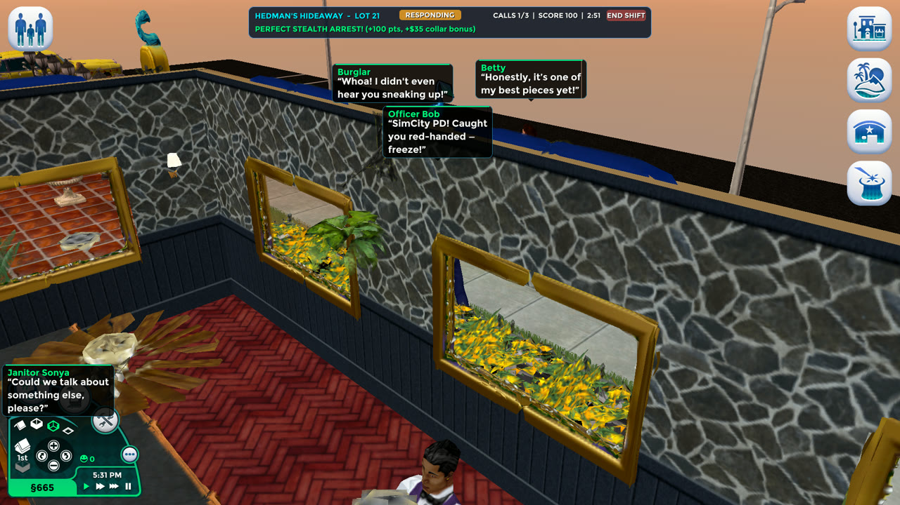 | 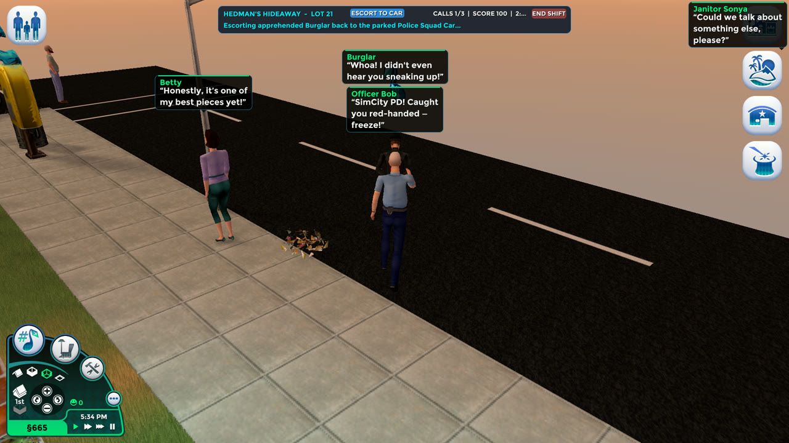 |

| Loading Burglar Into Parked Police Squad Car | Civic Hazard Inspection (`patrol_inspect_clue`) |
| :---: | :---: |
| 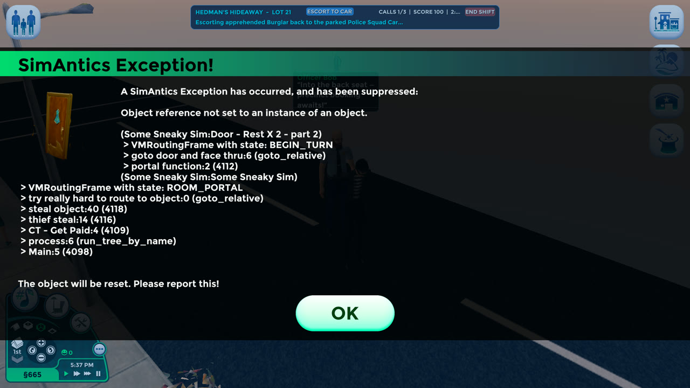 | 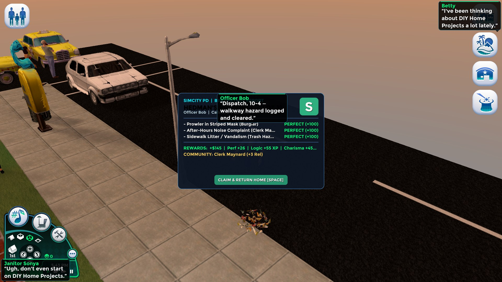 |

| S-Rank Shift Scorecard & Seamless Return Home |
| :---: |
| 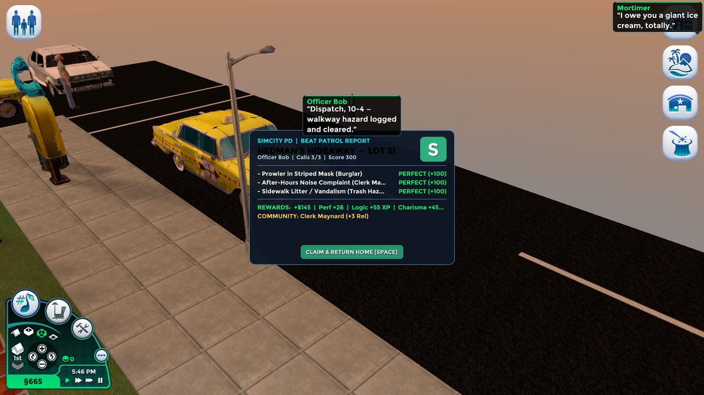 |

> **Instant Dev/Test Commands (`SimTestHook` pipe):**
> - `convo dispatch toast <SimName> [cadet|patrol]` — trigger the mid-shift Radio Dispatch toast
> - `convo dispatch start` — jump straight into **Lvl 1 Security Guard (CCTV Night Watch)**
> - `convo dispatch cadet <SimName> <BodyLvl>` — jump straight into **Lvl 2 Cadet (Academy Obstacle & Drill)**
> - `convo dispatch patrol <SimName> [lotId] [seed]` — jump straight into **Lvl 3 Patrol Officer (Real-Lot Live Beat Patrol)**

# Why is it called Simitone?

Simitone -> Semitone -> musical term -> C# -> a note

Further questions can be directed at my PR manager, uh, ... burglar cop.
