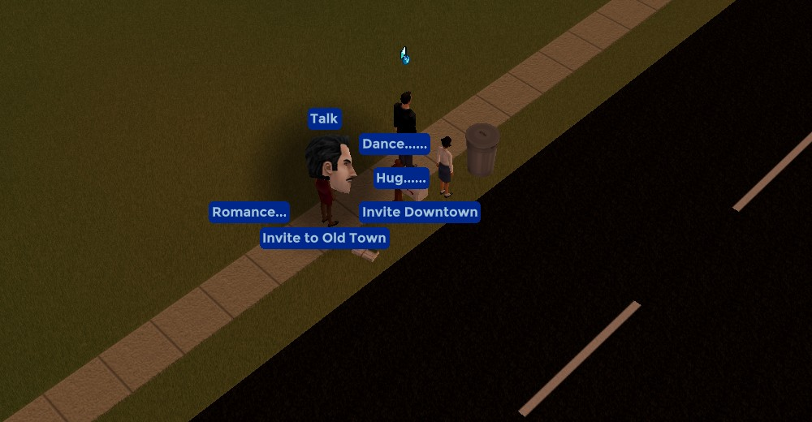
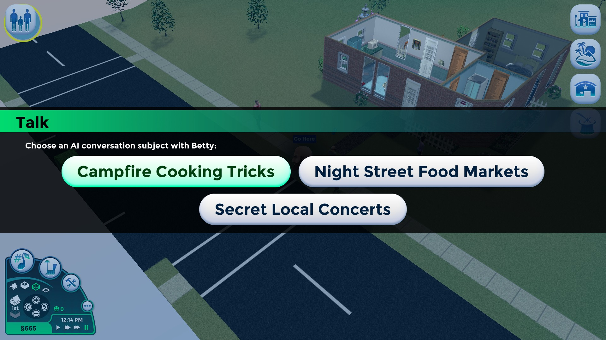
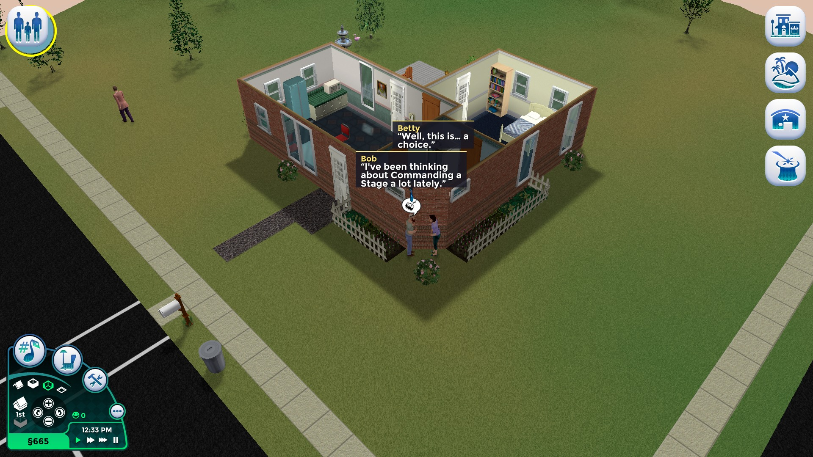
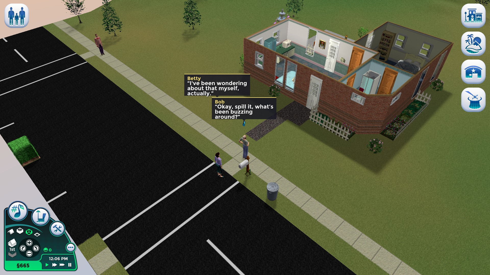
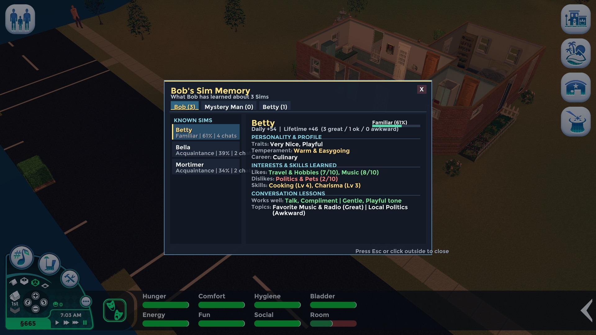

[Latest Pre-release](https://github.com/riperiperi/Simitone/releases/latest/) | [Download](https://github.com/riperiperi/Simitone/releases/latest/download/SimitoneWindows.zip)

Alternative C# Windows Frontend for The Sims 1, based off of FreeSO. http://freeso.org 
(***REQUIRES*** a legitimate copy of The Sims: Complete Collection)

NOTE! Currently does not support the entire Fame career track, saving on vacation and a few other important things. While all objects run, many of them have bugs that can make certain lot types unplayable. For current development progress, see [this issue.](https://github.com/riperiperi/Simitone/issues/8)

*Only for Desktop Windows.* Other platforms cannot be officially supported.

# Purpose

On modern operating systems, The Sims has a few nagging issues that make it less than playable. Simitone can be seen as a tool to improve the playability of your existing installation of The Sims. Here are some features:

- Playable in 3D - using a combination of models generated from the 2D sprites and created by the community.
  - [Download the mesh pack here!](http://forum.freeso.org/forums/3d-remeshing.40/)
- Custom user interface that works at modern resolutions. Working on a more desktop oriented interface.
- Improved graphical performance, support for high resolutions and refresh rates.
- Custom lighting - directional lights with smooth falloffs and shadows using generated 3D meshes.
- *Volcanic*, a program which allows you to examine, modify and create new game objects. (from FreeSO)

# AI Conversations & Sim Memory Mod

This fork includes an optional **AI Conversations & Sim Memory** mod (`Tools/Conversations`) powered by a bundled local [Laya](https://github.com/laya-ai) model (runs offline on CPU, no live LLM at play time):

- **Autonomous parallel room conversations:** awake adult Sims in the same room automatically chat with each other **without interrupting their ongoing activities** whenever their Social need drops to `<= 60%`.
- **Laya-driven social intelligence:** chooses verbal interactions and AI talk subjects based on each Sim's knowledge of the listener, skills (Charisma, Cooking, Mechanical, Creativity, Logic, Body), moods, and past social history.
- **Per-Sim Social Memory & floating dossier window:** every conversation records what a Sim has learned about each Sim they know — **Daily / Lifetime** relationship, familiarity %, revealed personality traits, observed temperament, career, liked/disliked interests, discovered skills, and discussed topics — accessible from the **Sim Memory** button in the selected Sim's Live-mode panel (right alongside Needs, Career, Personality, Relationships, and Inventory).
- **Simplified manual pie menu & 100% AI Talk subjects:** clicking another adult Sim shows one **Talk** bubble and a **Romance** submenu next to the usual interactions (Options: "Pie menu: Simplified / Full"); Talk presents 3 Laya-ranked AI subjects rather than raw legacy interest labels.
- **Easy toggle:** enable or disable the entire mod anytime via **Options -> AI conversations** (green = on).

See [Tools/Conversations/README.md](Tools/Conversations/README.md) for architecture, Laya bundling, and installation instructions (`pwsh Tools/Install-Conversations.ps1`).

## Screenshots

### 1. Simplified Manual Pie Menu (Talk, Romance and the usual interactions)

### 2. AI Talk Subject Chooser

### 3. Live Over-Head Speech Balloons

### 4. Autonomous Parallel Room Conversations

### 5. Selected Sim Live Panel — Sim Memory Button

### 6. Floating Sim Memory Dossier Window

# Why is it called Simitone?

Simitone -> Semitone -> musical term -> C# -> a note

Further questions can be directed at my PR manager, uh, ... burglar cop.
