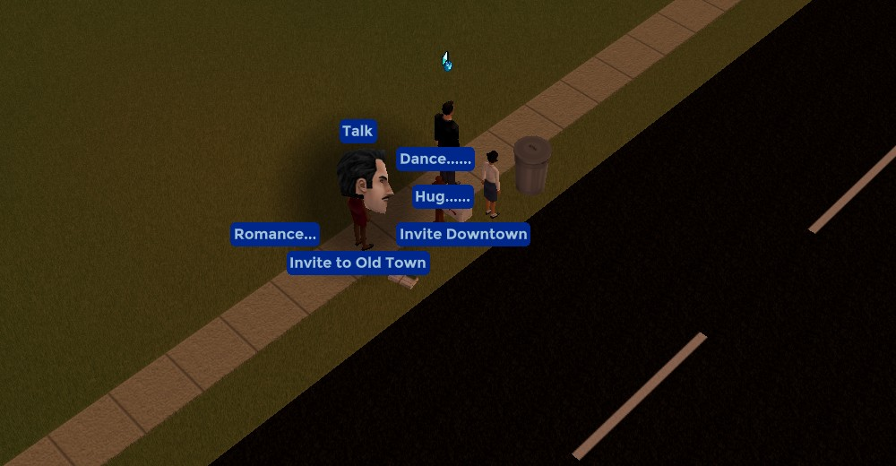
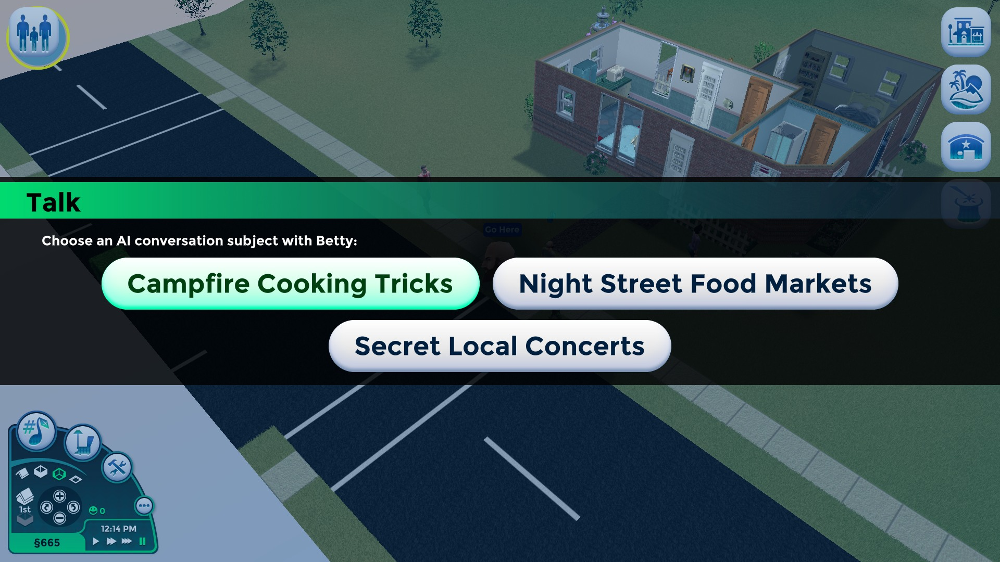
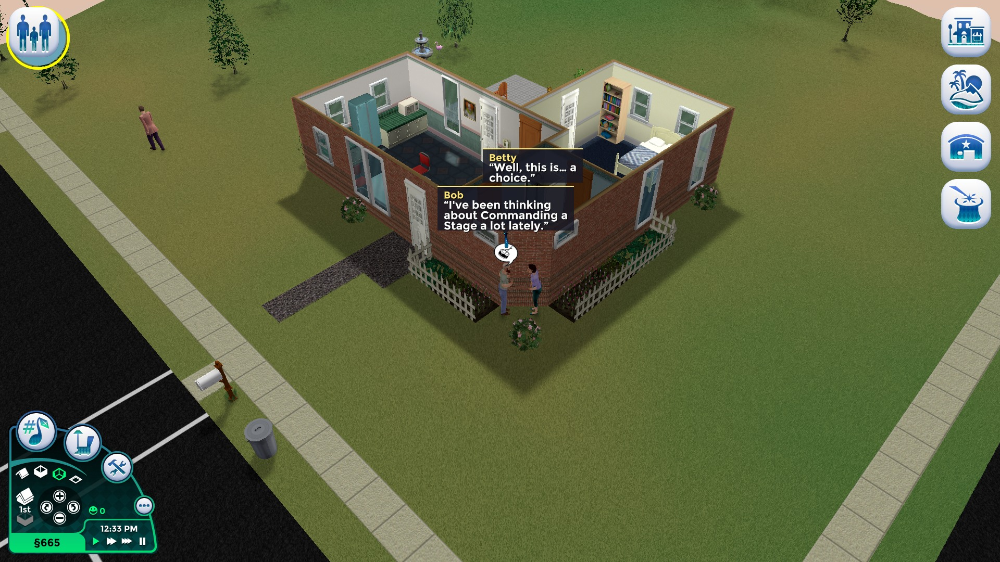
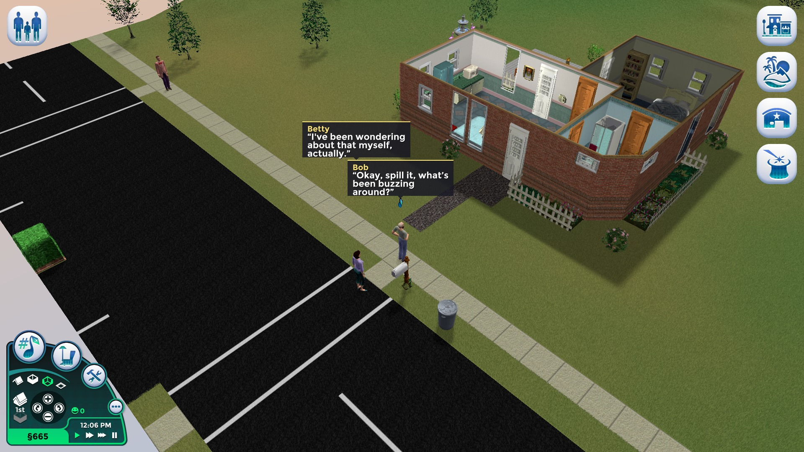
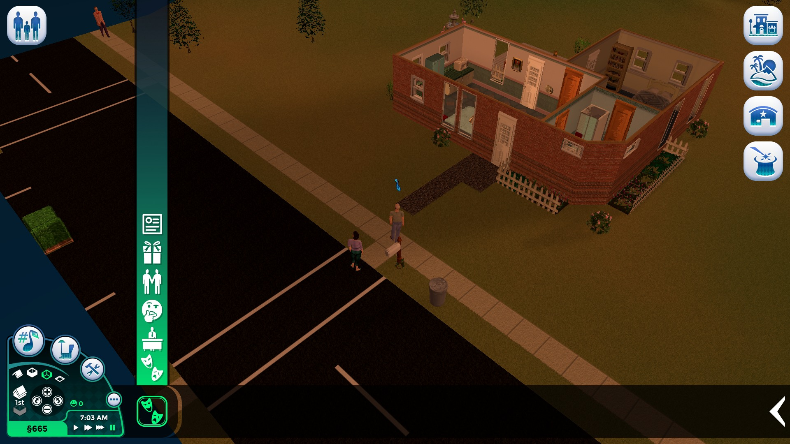
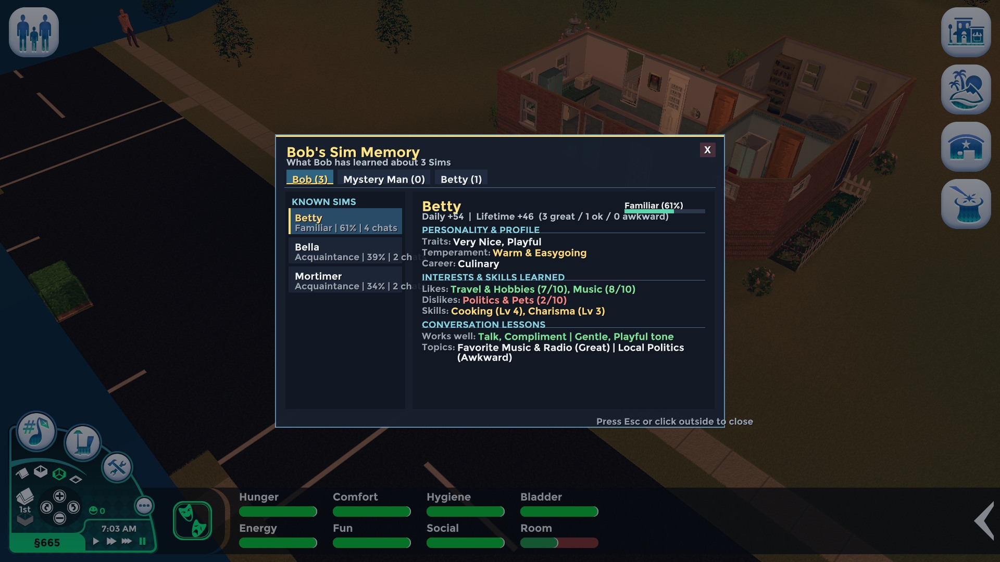

# AI conversations

Makes The Sims 1 social interactions livelier and autonomous:
- **Autonomous parallel room conversations:** awake adult Sims in the same room (or within 8 tiles outdoors) automatically talk to each other **in parallel with their ongoing activities** (without interrupting their interaction queue) whenever a Sim's Social motive is at or below **60%** (`<= +20` on `-100..+100`).
- **Laya-driven interaction & AI topic selection:** Laya (`/v1/systemone`) chooses both the verbal interaction (`talk`, `compliment`, `joke`, `brag`, `cheerup`, `apologize`, `flirt`, `tease`) and the AI talk subject, modulated by the speaker's **knowledge** of the listener (LTR/STR + observed history), both Sims' **skills** (Charisma reading/tact + Cooking/Mechanical/Creativity/Logic/Body topic resonance), and both Sims' **moods**.
- **News and gossip:** Sims notice what happens around them (promotions, new skill points, new friends, kisses, fights, gifts), pass it on in short conversations (greeting, the news, a question, goodbye), forget details with time and sometimes twist a rumour; the Sim Memory window has a **News** button showing what each Sim knows and how sure they are (`conversations.gossip.json`). See the section below.
- **Social memory, learned Sim dossiers & anti-negative-loop learning:** per-pair memory (`Documents\Simitone\conversations.memory.json`) records outcomes and structured facts each Sim learns about every Sim they talk with (traits revealed progressively, observed temperament, career, liked/neutral/disliked interests with 0–10 ratings, discovered skills with levels, what interactions/tones work vs. avoid, and AI topics discussed), penalizes recently failed interactions/tones/topics, engages de-escalation at `NegativeStreak >= 2`, enforces cool-down backoff at `NegativeStreak >= 3`, and resets on positive outcomes.
- **In-game Sim Memory button (Selected Sim Live Panel):** open **Sim Memory** (`live_memory.png`) right alongside **Needs, Career, Personality, Relationships, and Inventory** in the selected Sim's Live category switcher (or `simtool convo memory-ui tab`) to launch the floating **Sim Memory** dossier window for the currently selected Sim while keeping the bottom bar on your active Live tab.
- **Simplified manual pie menu:** clicking another adult Sim shows one **Talk** bubble and one **Romance** submenu, plus everything else the game offers (friendly Hug, Dance, Joke, Tickle, Give Gift, ...) unchanged. Children, pets, self, ungreeted visitors, non-social NPCs and feature-off keep the unmodified menu. The Options button **"Pie menu: Simplified / Full"** switches to the game's own full menu (remembered in `DocumentsSimitonenversations.menu`).
- **100% AI Talk subjects:** both manual Talk dialogs and autonomous parallel Talk draw exclusively from the AI Subject Bank (`bank.json` `subjects` + 48 curated built-in AI subjects) ranked by Laya—never raw hardcoded Sims 1 interest labels (`"Travel and Toys"`, `"Sixties and School"`, etc.).

## What the player sees
- **Autonomous parallel chatter:** when a Sim in a shared room hits Social `<= 60%`, speech balloons appear over both Sims' heads while they keep cooking, eating, reading, or watching TV. Both Sims' Social motives and STR/LTR update cleanly; concurrent exchanges in different rooms coexist (up to 4 active balloons).
- **Manual Sim pie menu:** on adult human Sims the several Talk variants become one **Talk** bubble and the romantic actions (Flirt, Kiss, Romantic/Intimate/Leap-Into-Arms Hug, Back Rub, Slow/Romantic Dance, Propose) move into **Romance**. Friendly Hug, plain Dance and all other interactions stay on the menu under their own names. Only the Chat and Gossip variants of Talk are folded into the single Talk bubble.
- **Manual Talk:** a dialog `"Choose an AI conversation subject with Betty:"` with three AI-generated subjects ranked by Laya for the two Sims. Choosing one maps cleanly to its underlying Sims 1 interest slot (`0..7`), updates `SocialMemory`, and displays both spoken lines.
- **Manual Romance / scripted socials:** a dialog `"What do you say to Betty?"` with three lines (Gentle / Playful / Bold). After the choice, the game plays the social, `OutcomeResolver` shifts the outcome by at most one step using Laya's temperament classification, `SocialMemory` records the result, and balloons show both lines.
- **Selected Sim Live Panel — Sim Memory:** sits in the Live category switcher right next to Needs, Career, Personality, Relationships, and Inventory. Selecting it opens the floating **Sim Memory** dossier window focused on the currently selected Sim (showing Known Sims, Familiarity %, Daily/Lifetime relationship, revealed traits, likes/dislikes, skills, career, and discussed topics; `Esc`, `[X]`, or click outside to close) while leaving the bottom bar on your current Live tab.
- **Options menu:** an **"AI conversations"** button (speech-bubble icon) switches the whole feature on and off; green = on. When off, parallel chatter stops and the full unmodified Sims 1 pie menu returns. Saved in `Documents\Simitone\conversations.profile`.
- Children, pets, self, ungreeted visitors, and anything the feature does not recognise keep the game's original behaviour.

## Screenshots

| Feature | Preview |
|---|---|
| **Simplified Pie Menu** (Talk + Romance) |  |
| **AI Talk Subject Chooser** |  |
| **Over-Head Speech Balloons** |  |
| **Autonomous Parallel Room Chat** |  |
| **Selected Sim Live Switcher** (`Sim Memory`) |  |
| **Floating Sim Memory Dossier** |  |

## How autonomous & manual choices are decided
1. **Manual socials (policy B):** Laya reads a short description of the receiver and classifies temperament (`easily_offended`, `thick_skinned`, `cold`, `receptive`). `OutcomeResolver` shifts the game's outcome by `-1`, `0`, or `+1`. Unknown temperament or Laya down = no shift.
2. **Autonomous parallel room chatter (`ParallelSocialPlanner` + `SocialIntelligence`):**
   - Runs off the VM tick thread (`ThreadPool`) so gameplay never stalls.
   - Computes **Knowledge** (`0..1`) from LTR/STR + observed exchanges; low knowledge blurs/redacts the listener's temperament, interests, skills, and mood in the Laya prompt so strangers make realistic missteps while close friends read each other accurately.
   - **Charisma** improves accuracy and mood reading; shared/known **Cooking, Mechanical, Creativity, Body, and Logic** skills boost affinity for matching AI subjects.
   - **Mood** affects tact (low speaker mood raises error/impatience; perceived low listener mood favors `cheerup`/`talk`/`compliment`).
   - **SocialMemory** penalizes failed interactions/tones/subjects, forbids risky options and switches to de-escalation at 2 consecutive failures, backs off the pair at 3 failures, and resets on a great outcome.
   - If Laya is unavailable or times out, deterministic trait/skill/mood/memory scoring takes over seamlessly.

## Laya ships with the game
`Boot.Startup` (called from the game's Main) starts `python -m laya.serve` in the background: bound to `127.0.0.1` only, on a free
port, with a random API key, hidden, and tied to the game by a Windows job object so it stops when the game does (even on a crash).
It looks for a bundled `laya\python\python.exe` next to the game first, then a system Python (`py -3.11`, `python`).
Laya itself is not in this repository. `Tools/Package-Laya.ps1 -Game <game folder>` builds the bundle: embeddable Python 3.11,
CPU PyTorch, `laya[serve]` and only the English weights, 1.7 GB in total, then self-tests it offline. Nothing needs to be installed
on the PC and no GPU is needed. The bundled copy runs with `HF_HUB_OFFLINE=1`, its own `HF_HOME` and `PYTHONNOUSERSITE=1`.
Every request names the `english` checkpoint (newer Laya versions route to a multilingual one otherwise, which is not bundled).
Set `SIMITONE_LAYA_URL` (and `SIMITONE_LAYA_KEY`) to use an already running server instead (development).

## The lines and AI subjects (no live LLM at play time)
`Content\conversations\bank.json` holds both the dialogue lines (`speaker`, `reply`) and the AI Talk subjects (`subjects`).
The lines are written by hand (no language model is used to make them): edit the files in `Tools/Conversations/bank/lines/*.txt` (the format is described at the top of the first file), then run `pwsh Tools/Conversations/bank/Build-Bank.ps1` to assemble `bank.json`. The script keeps the `subjects` list already in `bank.json`.

Every line and subject passes validation (length, characters, blocked words, no raw TS1 interest labels), and when the game loads the bank it also drops any line with asterisks, quote marks, dashes used as punctuation or no sentence ending (`DialogueBank.IsCleanLine`). The shipped bank is tested for zero dropped lines and for lines in every combination the game can ask for (`RepoBankLinesTests`). Missing bank entries fall back to built-in lines and built-in AI subjects, so there is never an empty line or raw TS1 topic.
Placeholders: `{me}` speaker, `{name}` receiver, `{job}` receiver's job title, `{topic}` AI Talk subject.

## How it plugs into the game (no game source is edited)
- `Tools/SpriteCardsPatch` (given `Conversations.dll` as 4th argument) patches `FSO.SimAntics.dll` with four idempotent Cecil hooks (plus the Options menu toggle in `Simitone.Client.dll`):
  1. `VMContext..ctor` -> `Boot.OnContextReady(this)`: installs conversation primitives (`ConvoPrimitive`, `ConvoApplyPrimitive`, `ConvoTalkPrimitive`) and swaps global script 397.
  2. `VMThread.ExecuteSubRoutine` -> `ConvoTalkPrimitive.OnSubRoutine(frame, opcode)`: intercepts the Talk topic routine (`select topic I like.` / `SHD select topic I like`) to present 3 AI subjects.
  3. `VM.InternalTick(uint)` -> `Boot.OnTick(this)`: drives `ParallelSocialDriver` on simulation ticks without touching `VMThread.Queue`.
  4. `VMEntity.GetPieMenu(VM, VMEntity, bool, bool)` -> `Boot.FilterPieMenu(list, this, vm, caller)`: folds the Talk variants into one `Talk` bubble and groups the romantic actions under `Romance`, leaving every other interaction as the game made it (never touches SimAntics autonomy).

## Layout
| Path | What |
|---|---|
| `Logic/` | Pure `net461`/`net9.0` logic, zero game types, unit tested: `Traits`, `OutcomeResolver`, `DialogueBank`, `LayaClient`, `LayaHost`, `TopicLogic`, `AiSubjectBank`, `SocialMemory`, `SimMemoryViewModel`, `SocialIntelligence`, `ParallelSocialPlanner`, `PieMenuLogic`, `BalloonLayout` |
| `Game/` | Game runtime: `Boot`, `ParallelSocialDriver`, `ConvoPieMenu`, `ConvoPrimitive`, `ConvoTalk`, `ConvoOverlay`, `SimMemoryMenu` |
| `bank/` | `bank.json` (built dialogue lines + 48 AI Talk subjects) and review sheets |
| `../Conversations.Tests` | 316 unit tests |
| `../Package-Laya.ps1` | Builds the bundled Laya |
| `bank/lines`, `bank/Build-Bank.ps1` | The hand-written dialogue lines and the script that assembles `bank.json` |
| `../Install-Conversations.ps1` | Patches a pristine release and installs into a game folder |
| `../PatchTests/ConversationsPatchTests.cs` | Cecil patcher integration & idempotency tests against the real release |

## Install
    pwsh Tools/Install-Conversations.ps1 -Pristine <unmodified v0.8.12> -App <game folder>
and make sure Python with `laya` is available (or a bundled `laya\python`).

## News and gossip (Sims talk about things that really happened)
The design follows Rumor Village (github.com/manuelgscom/rumor-village, MIT): the engine owns the state and decides what is allowed, nothing is decided from the text of a balloon. No language model is involved.
- **Facts** (`Logic/Gossip/GossipModel.cs`): the truth of something that happened. A kind (`Promoted`, `SkillGain`, `Friendship`, `Romance`, `Argument`, `Gift`), a label (job title, skill) and slots that can be remembered wrongly: who, with whom, amount (skill level), when (game day).
- **Minds** (`GossipBook`): each Sim holds their own version of every fact they know. Per slot: unknown, sure, doubt (somebody's guess) or forgotten, plus who told them. Seeing it happen makes every slot sure; hearing it fills gaps but never overwrites what the Sim is sure of (a different value is a conflict). Memories fade a little each game day (a forgotten slot loses its old value for good) and a doubt may harden into "sure": that is how rumours get twisted, always starting as a declared guess.
- **Events** (`EventDetector` + `Game/GossipDirector.cs`): a new skill point, a promotion or new job, two Sims reaching friendship (STR 70), and kisses, flirts, insults, slaps, gifts and bad teases. Every adult Sim in the same room is a witness.
- **Validation** (`GossipValidator`): the engine checks every proposed action: the Sim must know the fact, may not repeat what the listener has been told or what they just said, every name and day must be real, and every told slot is compared with the Sim's own memory (faithful / declared guess / contradiction / invented / hardened doubt). A failing slot is cleared, never applied.
- **Conversations** (`GossipPolicy`, `GossipConversation`): greet, tell, ask, "no idea", bye, at most 8 turns. Telling depends on the Sim (Outgoing and Playful Sims gossip, kind but quiet ones keep things to themselves) and on how well they know the listener. Sims never gossip about the listener or about themselves. The whole conversation is played on a copy of the two minds off the game thread and applied on the game thread; the balloons appear two at a time. Autonomous chats pick "gossip" whenever the speaker has news the listener has not heard.
- **Wording**: hand-written (`bank/lines/06-gossip.txt`): greetings, goodbyes, lead-ins by tone, news per kind in a "sure" and a "hedged" version, questions, reactions to what was just heard, "I saw it myself" / "X told me". A line is only used when every placeholder in it is something the Sim really says, and a Sim who saw it never says they only heard it.
- **Seen in the game**: Sim Memory window, **News** button (or `simtool convo memory-ui news`): what the Sim saw or heard, how sure they are, where it came from, who they passed it on to, and whether their version differs from what really happened. Saved in `conversations.gossip.json`.
- **Tests**: `GossipTests` (memory rules, validator table, policy, 2,000 frozen conversations with zero rejected or invented claims, planner), `GossipLinesTests` (every rendered balloon is a complete sentence), `GossipEventsTests`.
## Try it without clicking (simtool)
    simtool convo status                  enabled, Laya up, bank/subjects count, menu mode, parallel count, memory pairs, memory UI state, last decision
    simtool convo parallel                total parallel exchanges and last parallel decision
    simtool convo memory                  per-pair social memory summary
    simtool convo memory-ui open [Sim]    open the in-game Sim Memory Menu (optionally focused on Sim); also `close`, `select <Sim>`, `toggle`, `status`
    simtool convo trigger A B             immediately dispatch a parallel exchange from Sim A to Sim B
    simtool convo fact <kind> <Sim> [Sim]  make something happen (promoted, skillgain, friendship, romance, argument, gift); a Sim who is not on the lot is `#34=Name`, `by=Bob` = only Bob saw it
    simtool convo news [Sim]              what each Sim (or one Sim) knows;  `convo gossipstatus`, `convo gossip off|on`
    simtool convo menu full|simple   this run only: show the game's full pie menu or the simplified one (the Options button remembers it)
    simtool convo auto on|off        treat every Sim as not player-controlled (tests the autonomous path)
    simtool convo tone 1             skip the dialog and use tone 1 (0 Gentle, 1 Playful, 2 Bold)
    simtool convo force 3            force the outcome (test aid), `force off` to stop
    simtool convo last | log         last decision / log tail
    simtool interact Bob Betty "Talk"
    simtool convo interaction joke|off   force which kind of chat autonomous Sims pick (when it is possible for that pair); `convo near A B` = can they talk now; `convo forget 60` = a day of fading at 60%
    simtool persona Bob nice 900 outgoing 100   set personality points (0-1000); no traits = read them;  `setrel A B short long`;  `motives Sim -90`;  `focus A B` (camera)
    simtool record out.mkv 30 [fps]      record the game window to a video through ffmpeg (works in the background); use .mkv if you may stop it early

## Known limits
- Which script variant runs depends on the installed expansions; the hook finds the outcome step by its shape and logs
  `could not find the outcome store` if a variant does not match (the game then behaves as before).
- Parallel room chatter uses verbal interactions only (`talk`, `compliment`, `joke`, `brag`, `cheerup`, `apologize`, `flirt`, `tease`); physical socials remain in manual Romance or native scripts.
- Missing bank entries fall back to built-in lines and built-in AI subjects; to add lines, edit `bank/lines/*.txt` and run `bank/Build-Bank.ps1` (no language model is involved, in the game or in the build).
