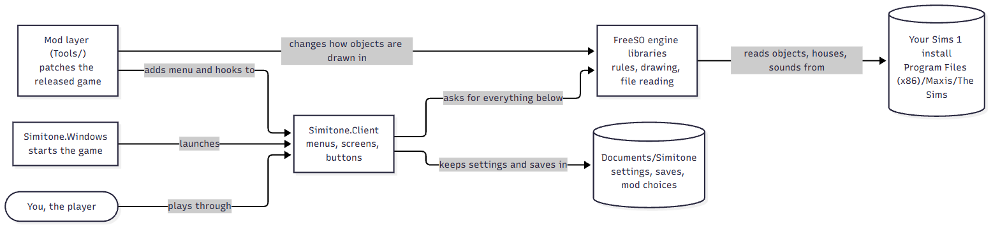
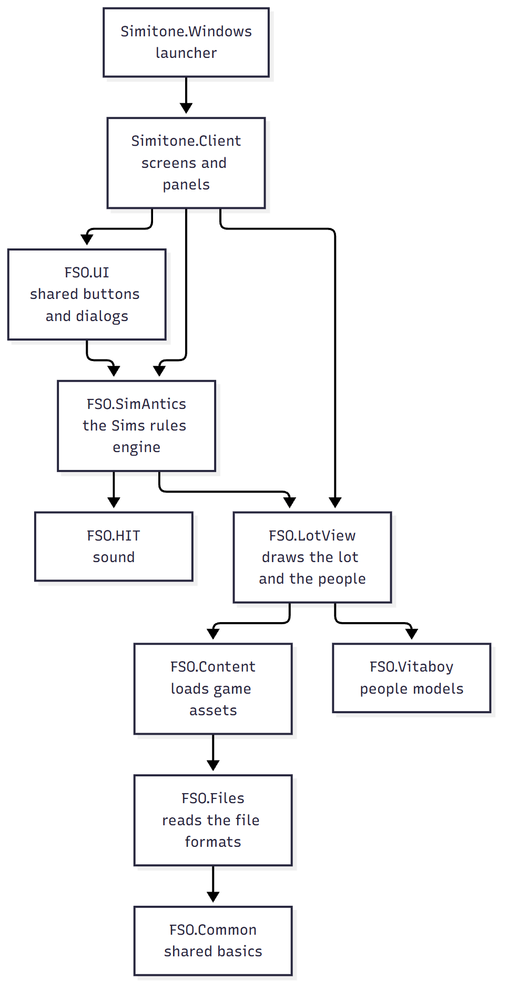
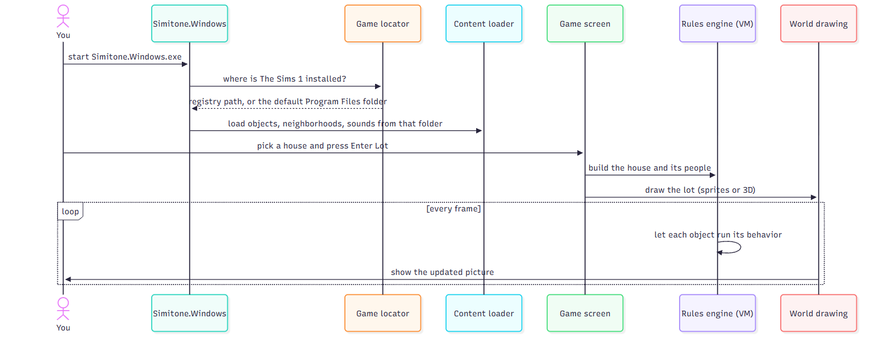
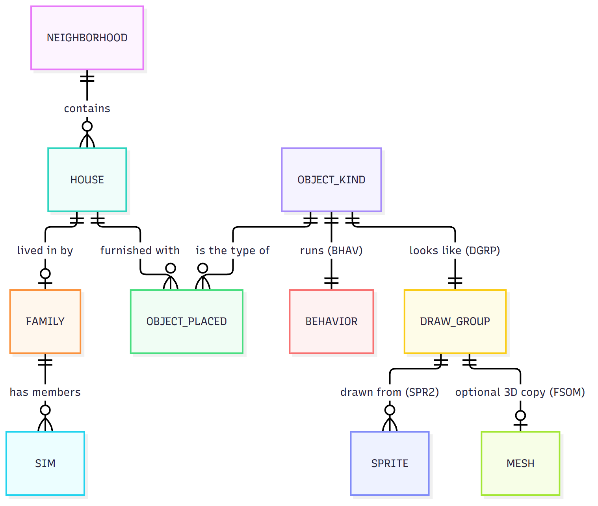
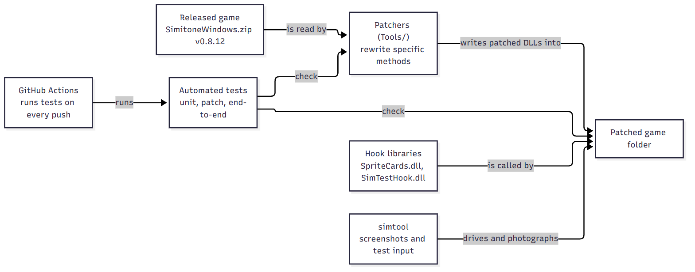
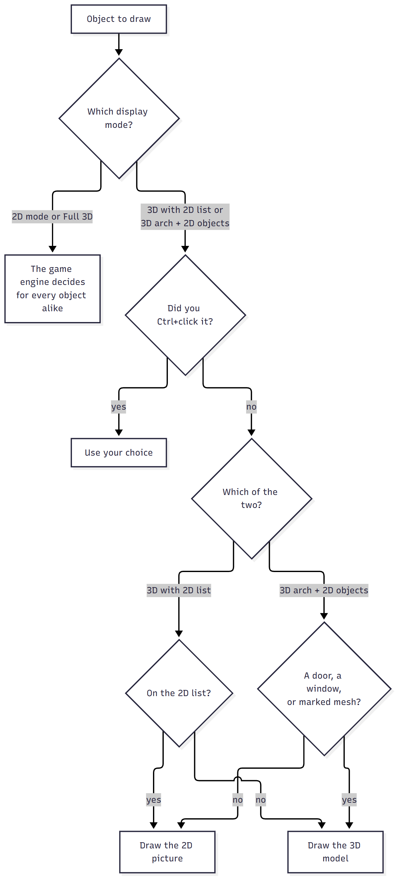

# Simitone (fork) — How it works

*Generated 2026-11-21 by the explain-architecture workflow. Diagrams: `diagrams/` (PNG), `architecture.pdf` (all-in-one), `src/` (editable sources).*

## What is this app?

It lets you play your own copy of The Sims 1 in a modern program. The original game looks and behaves badly on today's computers (tiny window, odd buttons, no widescreen). Simitone replaces the game's "front end" with a new one that works at any resolution, keeps the original game's rules, characters and objects, and can show the world in 3D. You still need your own Sims 1 files on disk; Simitone only reads them.

This repository is a **fork** (our own copy) of Simitone with extra tools we built: a menu for choosing how objects are drawn (2D pictures or 3D models), a "Ctrl+click an object" chooser, and tests that check all of it.

**Built with:** C# on .NET (the platform the code runs on), MonoGame (a toolkit for drawing graphics and handling input), and FreeSO (an open-source project from the same author whose engine Simitone reuses). The game itself runs on Windows.

## The big picture

**What you're looking at:** You play through *Simitone.Client*, the part with the screens, menus and buttons. *Simitone.Windows* is just the ignition key that starts it. Everything the game needs to know (what a fridge does, what a house looks like, what a sound is) comes from the *FreeSO engine libraries*, which read your Sims 1 install on disk. Your settings and saved neighborhoods go to a `Simitone` folder in your Documents. Nothing here uses the internet while you play. The *mod layer* is our addition: small programs that change a few parts of the already-built game.

## House tour — what each folder is for

- **`Client/Simitone/Simitone.Windows/`** — the ignition. It works out where The Sims is installed and starts everything (`Program.cs`, `GameLocator/`).
- **`Client/Simitone/Simitone.Client/`** — the dashboard and the rooms you walk through: the loading screen, create-a-Sim screen and the lot screen (`UI/Screens/`), plus every panel and button (`UI/Panels/`, `UI/Controls/`).
- **`FreeSO/TSOClient/tso.simantics/`** — the brain. Every Sims object carries a tiny program ("when a Sim uses me, do this"); this folder runs them.
- **`FreeSO/TSOClient/tso.world/`** — the stage crew. It draws the lot, walls, floors, objects and weather, either as flat pictures or 3D models.
- **`FreeSO/TSOClient/tso.content/`** — the librarian. It fetches objects, neighborhoods and sounds out of the original game's files.
- **`FreeSO/TSOClient/tso.files/`** — the translator. It understands the original game's file formats (IFF, FAR and others).
- **`FreeSO/TSOClient/tso.vitaboy.*`** — the wardrobe department. The 3D people and their clothes.
- **`FreeSO/TSOClient/tso.sound/`** and **`FSO.UI/`** — the sound booth, and the shared buttons and dialog boxes.
- **`FreeSO/TSOClient/FSO.IDE/`** — "Volcanic", a workshop for editing game objects.
- **`FreeSO/TSOClient/FSO.Server*`** — the online servers of FreeSO. Simitone doesn't use them (its projects don't reference them).
- **`Tools/`** — our workshop: patchers, a screenshot-and-clicking helper, the tests. Described below.

Note: on disk the folders are named `tso.*`, but they build into blocks called `FSO.*`. For example `tso.world` builds `FSO.LotView`.

## Following one action through the app

**What you're looking at:** (1) You start the game. (2) It asks the "game locator" where The Sims 1 lives, checking the Windows registry and falling back to the usual `Program Files (x86)\Maxis\The Sims`. (3) It loads objects, neighborhoods and sounds from that folder. (4) You pick a house and press *Enter Lot*. (5) The game builds that house and its people inside the rules engine, and the stage crew draws it. (6) From then on, every frame, each object runs its little program and the picture is refreshed. Steps 3 and 4 are inferred from the class names rather than traced line by line.

## What the app remembers (the data)

**What you're looking at:** There is no database. The "tables" are the pieces stored in the original game's files. A *neighborhood* contains *houses*; a house is lived in by a *family* made of *Sims*, and is furnished with *placed objects*. Every placed object is a copy of an *object kind*, which has a *behavior* (what it does) and a *draw group* (how it looks), made of *sprites*, the original flat pictures. Simitone adds an optional *mesh*, a 3D version. These relationships are inferred from the file-format names in `FSO.Files`, not read from a schema.

## How our changes get into the game

**What you're looking at:** We don't rebuild Simitone. We download the finished game (v0.8.12), and small programs called *patchers* rewrite specific spots inside its files. Extra *hook libraries* are called from those spots. A helper called *simtool* can start the game, take a window-only screenshot and send clicks, so tests can drive it. Tests run on every push to GitHub.

## Which model does an object get?

**What you're looking at:** The Options menu in a lot has four modes: **2D mode**, **3D with 2D list**, **3D arch + 2D objects** and **Full 3D**. In the first and last, the game engine decides for all objects together. In the two middle modes the choice is made object by object: your own Ctrl+click choice always wins; otherwise "3D with 2D list" uses the 2D picture only for objects on a list (magic portal, spellbook, radio, trees and plants), while "3D arch + 2D objects" uses 2D pictures for every object except doors and windows.

## Where to look when…

| You want to… | Go to |
|---|---|
| Change what a menu button looks like or does | `Client/Simitone/Simitone.Client/UI/Panels/` (the Options buttons are in `UIMainPanel.cs`) |
| Change what happens when you click a lot | `Client/Simitone/Simitone.Client/UI/Panels/UILotControl.cs` |
| Change how the game saves | `Client/Simitone/Simitone.Client/UI/Screens/TS1GameScreen.cs` (`Save()`) |
| Change the starting window size or settings | `config.ini` in `Documents\Simitone`, read by `FreeSO/TSOClient/FSO.UI/GlobalSettings.cs` |
| Change which objects use 2D pictures | `Tools/SpriteCards/spritecards.example.txt` (copied to the game's `Content\spritecards.txt`) |
| Change the rules for the four modes | `Tools/SpriteCards/ModeLogic.cs` (and its tests in `Tools/SpriteCards.Tests`) |
| Understand how a Sims object behaves | `FreeSO/TSOClient/tso.simantics/` |
| Fix "game can't find The Sims" | `Client/Simitone/Simitone.Windows/GameLocator/WindowsLocator.cs` |
| Run the checks | `Tools/ci.ps1` (build + tests) and `Tools/e2e/Run-E2E.ps1` (drives the real game) |

## Things to be careful with

- **Two versions of the game exist here.** The source code on `master` has been moved to a newer platform (.NET 9). The released game we actually run and patch is from January 2025 (older .NET Framework). Our patchers work on the *released* files, not on this source, so a change to the source does not change the game we play.
- **Patchers must always start from the original files.** Running them on already-patched files doubles the menu entries. Backups of the originals are kept outside the repo.
- **The hooks are fragile on purpose.** They depend on exact method names inside the released game. A different Simitone release will probably need the patchers updated; the patch tests in `Tools/PatchTests` exist to catch this.
- **The end-to-end test uses fixed click positions** for a 1920×1080 window and the "Newbie family" lot, so it breaks if the layout changes.
- **Your saves** live in `Documents\Simitone\UserData`. Back them up before experimenting with anything that touches saving.
- **Parts of the repo were not examined:** `FreeSO/Other`, `FreeSO/Charvatia`, `FreeSO/Documentation`, `FSOInstaller`, and the FreeSO server projects. They are not part of the Simitone game path as far as the project references show.

## Words used in this codebase

- **Lot** — one plot of land with its house and objects.
- **IFF / FAR** — the original game's container file formats (objects, houses, graphics).
- **Sprite** — a flat, pre-drawn picture of an object, the original look of The Sims 1.
- **Mesh** — a 3D model. Simitone builds one from each sprite unless a hand-made one exists.
- **Hybrid mode** — drawing some objects as sprites and some as meshes in the same scene.
- **Patcher / hook** — a program that edits the released game's files / a small library the edited files call.
- **SimAntics (VM)** — the rules engine that runs each object's behavior.
- **Volcanic** — the built-in editor for game objects.

---

*To give any AI coding agent instant understanding of this project, paste `AI-CONTEXT.md` (same folder) at the start of a session.*

## AI conversations (added later)

Before a social plays, the player picks one of three lines; the other Sim's reaction depends on their character; both lines are shown.
How it works, in plain words: the game already has one shared step where a social looks up its result. We replace that step with our own
(`Tools/Conversations`), which shows the choice, asks a small local program (**Laya**, started by the game itself) to label the other
Sim's temperament, and nudges the game's own result by at most one step. The lines come from a fixed list written ahead of time with
a local language model (`Tools/ConvoBank`), so nothing slow happens while you play. The Options menu has a switch for all of it.
Details, install steps and limits: `Tools/Conversations/README.md`. The rules the game uses for relationships: `RELATIONSHIPS.md`.
